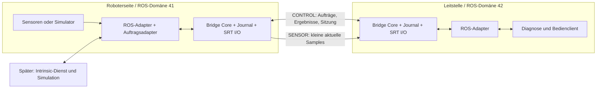

# Robotweax SRT: ROS-2-Brücke und Intrinsic-Core-Adapter

Datum: 2026-11-04 · Entwurf v0.1 · Status: M0 lokal qualifiziert, M1-Protokoll und native Sitzungen geprüft

Dieses Dokument legt den ersten Implementierungsumfang fest. Die
[HANDOFF.md](HANDOFF.md) enthält Arbeitsreihenfolge, Einstieg und Abnahmekriterien.
Der umgesetzte Teilumfang ist im README und in den Nachweisen markiert.
Alle übrigen neuen Pakete, APIs, Konfigurationsdateien und Tests sind weiterhin
**zu implementieren**. Bestehende Upstream-Schnittstellen werden ausdrücklich
als solche bezeichnet. Es liegt kein Integrationsbenchmark vor. Den tatsächlichen Implementierungs- und
Prüfstand dokumentieren [README.md](README.md) und die
[M0-Evidenz](evidence/m0-2026-11-04/README.md); die übrigen Komponenten sind weiterhin geplant.

## 1. Ziel und erster Anwendungsfall

Zwei ROS-2-Systeme tauschen über eine beeinträchtigte IP-Verbindung ausgewählte
kleine Sensornachrichten und bestätigte übergeordnete Aufträge aus. Robotweax SRT
liefert dafür zwei explizite Transportprofile:

- **SENSOR:** aktuelle, voneinander unabhängige Samples; FEC ohne DATA-ARQ.
- **CONTROL:** vollständige, geordnet zugestellte Anwendungsnachrichten mit ARQ.

Der erste Demonstrator überträgt simulierte IMU- und Gelenkzustände von einer
Roboterseite zu einer Leitstelle. Die Leitstelle ändert mit einem CONTROL-Auftrag
die Messrate eines simulierten Geräts und erhält ein überprüfbares Ergebnis.
Anschließend wird dieselbe Brücke für Zustandsbeobachtung und einen simulierten
Diagnoseauftrag an Intrinsic Core angebunden.

Das erste Produktziel ist eine selektive WAN-Brücke. Ein vollständiges `rmw_srt`,
automatische Übertragung des gesamten ROS-Graphen, Motor-Sollwertströme, Not-Halt,
harte Echtzeit, große Bild-/Punktwolkentransfers und allgemeine ROS-Actions gehören
nicht zum MVP. Für Bilder bleibt ein gesonderter LIVE-Medienpfad möglich.

## 2. Quellenstand und Abhängigkeiten

| Komponente | Festgelegte Ausgangsbasis | Bedeutung |
| --- | --- | --- |
| Lokaler SRT-Checkout | `09ceab33e1fc190472558fdb4d873f38b76fa320`, CMake-Version 0.2.8 | Für die erste Analyse gelesen; älter als der Implementierungskandidat. |
| SRT-Implementierungskandidat | `52be7c86ee1f303cbb0c8718c364217e4dd97a36`, CMake-Version 0.3.1 | CONTROL, SENSOR und SESSIONAUTH-Dokumentation sowie Buildoptionen gelesen; Build/Laufzeit in M0 noch zu qualifizieren. |
| Intrinsic Core | `723c3ee01f155f7a8bb04e449d917fe8ac5784e9` | README und ICON-/ROS-2-Brücke gelesen; kein Intrinsic-Lauf ausgeführt. |
| ROS-MVP | ROS 2 Jazzy, Ubuntu 24.04, Linux amd64 | Beide Brückenenden mit identischen ROS-Typ-Paketen; Paketversionen und Image-Digest in M0 festhalten. |
| Intrinsic-Ausbau | ROS-Umgebung des gepinnten Intrinsic-Runtimes | README nennt Lyrical. Eigener Build und eigene Integrationsspur; Jazzy-Binaries nicht in dessen Prozess laden. |

Ein SHA ist eine reproduzierbare Referenz, keine Produktionsfreigabe. M0 erstellt
`baselines/dependencies.json` mit tatsächlichen SHAs, Image-Digests, ROS-/RMW-
Paketversionen, Compiler, OpenSSL und Buildflags. Änderungen daran werden als
neue Vergleichsbasis dokumentiert. `srt_getversion()` ist die kompatible SRT-API-
Version und identifiziert weder Robotweax-Release noch aktivierte Erweiterungen.

Die Quellen [S1–S6](#12-quellen) sind für Profilverträge maßgeblich. Der lokale
Checkout wird durch diese Dokumentation weder aktualisiert noch umgebaut.

## 3. Architektur und Verantwortlichkeiten

Repository-Zuordnung (Projektübernahme 2026-11-04): M0–M3 und die generische
ROS-2-Brücke liegen in
[Robotweax/ros-2-srt-bridge](https://github.com/Robotweax/ros-2-srt-bridge).
Der spätere Intrinsic-Adapter M4 liegt in
[Robotweax/intrinsic-core-srt-integration](https://github.com/Robotweax/intrinsic-core-srt-integration).
SRT bleibt eine separat installierte Abhängigkeit.



Pro Gegenstelle werden zwei getrennte SRT-Verbindungen verwendet. Die
Roboterseite ist im MVP Caller für beide Verbindungen; die Leitstelle Listener
auf zwei festen UDP-Ports. CONTROL ist bidirektional. SENSOR sendet im MVP von
der Roboterseite zur Leitstelle. Eine Listener-Rolle verhindert nicht das Senden
von Aufträgen über die bereits aufgebaute CONTROL-Verbindung.

| Geplantes Paket | Zuständigkeit |
| --- | --- |
| `robotweax_srt_bridge_core` | ROS-unabhängige C++20-Bibliothek: Wire-Format, Routen, Sitzungen, Zeitmodell, begrenzte Queues, SRT-I/O und Auftragsjournal. |
| `robotweax_srt_bridge_msgs` | Eigene Auftrags-/Statusschnittstellen, typisierte Fehler und Diagnosemeldungen. |
| `robotweax_srt_bridge` | `rclcpp`-Node, typisierte ROS-Adapter, Konfiguration, Lifecycle und lokale QoS. |
| `robotweax_srt_bridge_demo` | Simulator, idempotenter Messraten-Handler, Client und Assertions. |
| `robotweax_intrinsic_adapter` | Späterer Adapter zu freigegebenen Intrinsic-Schnittstellen außerhalb des Echtzeitthreads. |

Der Core verwendet nur `<srt/srt.h>` und den installierten CMake-Target
`RobotweaxSRT::srt`. Ein SRT-Provider pro Prozess; keine Verknüpfung mit einer
zweiten libsrt-Implementierung. Vorhandene FEC-, Crypto- und Recovery-Engines
werden verwendet, nicht nachgebaut.

Ein I/O-Owner verwaltet Sockets, epoll, Verbindungszustand und Reconnect.
ROS-Callbacks legen begrenzt besessene Daten in Queues; sie warten weder auf
Netzwerk noch auf Journal-I/O. Ein begrenzter Worker übernimmt SQLite; Auftragsausführung benötigt eine
separate, widerrufbare Startfreigabe außerhalb des I/O-Owners. Anwendungscallbacks laufen außerhalb interner Locks.
Shutdown beendet Admission, löst lokale Futures mit einem belegbaren Status auf,
schließt I/O und joint Worker, bevor Speicher freigegeben wird.
Vor dem Socket-Close sind höchstens zwei Sekunden für Anwendungsbestätigungen
vorgesehen. Beide Sockettypen setzen im MVP `SRTO_LINGER={0,0}`; der CONTROL-
Default von 180 s wird ausdrücklich nicht übernommen. Noch unbestätigte Aufträge
bleiben im Journal und erhalten keinen künstlichen Erfolg. Ein Close widerruft
keinen bereits beim Empfänger laufenden Auftrag. Reconnect-Waits sind abbrechbar;
der Lifecycle-Test verlangt ein vollständiges Beenden innerhalb von fünf Sekunden.

Implementierungsstand 2026-11-05: `RobotweaxBridge::transport` besitzt Sockets,
epoll, Session, Queues, Bandbreitenbudget und zwei Reconnectpläne in genau einem
Thread. Numerische IPv4-/IPv6-Endpunkte vermeiden DNS im Owner. Send/Receive sind
nichtblockierend, epoll wartet höchstens 10 ms; Arbeit pro Iteration ist begrenzt.
Die feste CONTROL-Empfangsmailbox hat 64 FIFO-Plätze; bei voller Mailbox pausiert
IN-Readiness. SENSOR bleibt latest-only pro Route. Externer Submit kopiert Payloads
begrenzt und verwendet Try-Lock. BUSY bedeutet Kapazität oder Lock-Konkurrenz.
Der ursprüngliche Ingresszeitpunkt bleibt erhalten. CONTROL-Kontexte binden Session
und CONTROL-Generation; SENSOR-Kontexte zusätzlich die SENSOR-Generation. Ein reiner
SENSOR-Wechsel verwirft keine CONTROL-Arbeit und widerruft keinen Command-Grant.
Clock-Verlust oder CONTROL-Verlust widerruft die betroffenen Grants.

Periodische Probes beginnen bereits in der Synchronisierung. Unabhängige zufällige
Jitterseeds dekorrelieren Reconnectpläne; permanente Sessionfehler bleiben gesperrt.
CONTROL-Aufträge benötigen kein erfolgreiches SENSOR-Binding.

`RobotweaxBridge::worker` startet per posix_spawn einen Linux/glibc-Child, auch nach
Start der Transportthreads. Kein Anwendungs-fork des threaded Parent. Der Child
übernimmt die einzige Journalverbindung. Private IPC v2 nutzt feste 2.048-Byte-
SOCK_SEQPACKET-Frames und maximal 64 ausstehende Requests. Der aktuelle Monotonic-
Zeitpunkt im Child bei Operationsstart schließt IPC-Wartezeit in die Deadline ein.
Standardstreams, IPC-FD und Execution-Pool-FD werden übergeben; andere Deskriptoren
werden vor exec geschlossen. Netzwerkformat und Command-Schema bleiben unverändert.

Nur neu committed LOCAL_QUEUED erzeugt ein einmaliges Sender-Ticket. GET, Duplikat,
Empfängeradmission, Ablauf und Speicherfehler erzeugen keines. COMMAND-Ingress ist
auf 56 von 64 Plätzen begrenzt; acht bleiben QUERY/STATUS vorbehalten. Vor Send
prüft der Owner Peer, Epoch, Route, Budget, Kontext, bekannte Worker-Liveness und
Deadline. Worker-Stop bzw. erkannter Fehler widerruft Tickets. Bereits begonnene
Sends können nicht zurückgenommen werden; sie bleiben dauerhaft gespeicherte
Absichten, keine Ausführungsbestätigung.

Ein frisch committed DISPATCHING erzeugt ein separates `DispatchTicket`. Die 64
asynchronen Owner-Checks bleiben Momentaufnahmen. Erst `request_command_start`
verknüpft Dispatch-Beleg und aktuelle Session-/Frischeprüfung mit einem gemeinsamen
Start-Fence. Ein versiegelter memfd-Pool besitzt 64 feste Slots mit Generationen,
Request-ID, Payloadhash und Deadline. Nur lock-free 64-Bit-Atomics sind zugelassen;
diese native Shared-Memory-ABI wird ausschließlich auf der qualifizierten
Linux-Plattform verwendet und ist kein Netzwerkformat.

Die Zustände PREPARED -> GRANTED -> RUNNING bzw. REVOKED werden atomar entschieden.
Der CAS des Child von GRANTED nach RUNNING ist der Handler-Eintrittspunkt. Widerruf
und Start haben je Fence genau einen Gewinner; der Owner widerruft vor Socket-Close
und Veröffentlichung des verlorenen Kontexts. RUNNING wird nicht nachträglich
widerrufen. Generationen und begrenzte Lebenszeiten verhindern ABA/Replays; ein nach
Child-Ausfall zurückgelassener RUNNING-Slot wird im fehlgeschlagenen Pool nicht
wiederverwendet. Hash und ID müssen dem gespeicherten Dispatch-Beleg entsprechen.

Grant-Deadline ist das Minimum aus konservativer Command-Frische, ursprünglicher
lokaler Deadline und Probe-Alter-/Driftbreiten-Qualifikation des ClockMappers.
Der Child prüft sie unabhängig vom Owner-Tick. Spätere Probes verlängern bestehende
Grants nicht. Nach Grantverlust ohne Wirkung werden REJECTED/CONTEXT_LOST oder
EXPIRED/START_DEADLINE gespeichert, bevor eine entsprechende Antwort folgt.
Ein bereits laufender Handler darf sein tatsächliches Ergebnis persistieren.

`RobotweaxBridge::endpoint` verbindet dies durch einen eigenen Koordinatorthread.
64 lokale Inputs, 64 Events, 64 verfolgte Request-IDs und 64 verlorene Sessions
begrenzen seinen Speicher. Ein Workflow läuft jeweils seriell; das ist strenger
als maximal ein Dispatch pro Route. Sender-Commit vor Send, Empfänger-Commit vor
ACCEPTED, Dispatch-Commit vor finaler Freigabe und Ergebnis-Commit vor Endstatus
werden automatisch angewendet. Kontextverlust invalidiert alte Absichten;
ausstehende IDs werden bei Reconnect bzw. fehlender Antwort abgefragt. Erneutes
Execute mit derselben ID liefert das Journal bzw. QUERY, keinen neuen Send.

Der explizit aktivierte simulierte Rate-Handler läuft im beaufsichtigten Child,
nicht auf dem Netzwerk- oder Koordinatorthread. Er prüft erwartete/neue Generation,
setzt den absoluten Wert und persistiert das belegte Ergebnis. Sein Gerätezustand
ist flüchtig (initial 200 Hz/Generation 0) und startet mit dem Worker neu. Alte
Journaleinträge bleiben historische Ergebnisse, keine aktuelle Gerätezustands-
Garantie. M2 ergänzt einen externen ROS-Handler und einen getrennten Simulator
(siehe `evidence/m2-ros-jazzy-2026-11-05/ACCEPTANCE.md`).

Der Koordinator überwacht RPC/Checks (Default 3 s). Fehler schließen Admission und
Transport. Stop widerruft nicht konsumierte Grants/Tickets sofort; nach maximal
2 s Grace folgt SIGKILL. Einmalige 4-s-Joinfrist gilt auch bei Wiederholungen.
shutdown_timeout behauptet keinen erfolgreichen Join; ein Reaper hält keinen
Owner-Speicher. Endpoint-Tests qualifizieren Ende unter 5 s bei pausiertem Child,
Timeout, konkurrierenden Produzenten und voller Callback-Mailbox. Unaufgelöste
lokale Arbeit wird nach Stop aus begrenztem Speicher als Kontextverlust gemeldet;
das ist kein Beweis, dass ein alter Auftrag nie wirkte. Bekannte dauerhafte
Endergebnisse bleiben erhalten. Physisch ununterbrechbares Kernel-I/O ist damit
nicht zeitlich qualifiziert.

ERROR ist jetzt ein eigener, begrenzter Diagnosevertrag in `errors_v1.proto`.
Die bestehende Rate-Command-Descriptoridentität bleibt unverändert. ERROR läuft nur
Caller -> Listener auf CONTROL, mit nichtnull Route/Request-ID, gültiger aktueller
Session/Epoch/Domain und monotoner Routensequenz. Der Body nennt Code, ursprüngliche
COMMAND-/QUERY-Art, deren gesendete Sequenz und begrenzten Backoff für BUSY/CAPACITY.
Keine Freitexte, Journalzustände oder Geräteergebnisse. ERROR löst kein ERROR aus;
Handshake-/Identity-/Replayfehler werden weiterhin verworfen bzw. schließen den Kanal.

Der Owner korreliert gegen einen festen Recent-Send-Cache für 64 IDs/Route-Slots,
jeweils letzte COMMAND- und QUERY-Sequenz. Fremde/alte/wiederholte Referenzen werden
nicht als Peerantwort ausgeliefert. CONTROL-Read pausiert auch vor voller eigener
Ausgangsqueue, damit begrenzte Gate-Diagnostik nicht unkontrolliert wächst. Die
normalen Queue-/Bandbreitenlimits gelten unverändert, kein Prioritäts-Bypass.

Der Endpoint antwortet mit BUSY/CAPACITY/CONFLICT/NOT_FOUND bei entsprechenden
Admission-/Queryfehlern; der Owner meldet ausgewählte Frische-/Body-Gatefehler.
Harte lokale Speicherfehler bleiben fail-closed und können vor einer Antwort den
Transport beenden. Ein empfangenes ERROR verändert das Journal nicht. Der lokale
CommandEvent enthält peer_error und peer_context, aber keinen autoritativen Entry.
Automatisches Query wird für diese ID in dieser Sitzung pausiert. Explizite Query
oder neue Sitzung setzt Reconciliation fort, niemals blindes COMMAND-Resend.
Bekannte Endergebnisse gewinnen gegen spätes ERROR; eine alte Command-Diagnose
überschreibt auch keinen persistierten Empfänger-Admit-Beleg. Ein fremder STORAGE-
Fehler vergiftet nicht das lokale Journal. Vor Admission erzeugte Diagnose reserviert
keinen Empfänger-Request; deshalb bleibt die Senderabsicht dauerhaft maßgeblich.

Das CMake-SDK exportiert aktivierte RobotweaxBridge-Targets, Header, Protobufquellen
und Worker. Ein installierter Consumer wird nach Verschiebung des gesamten Prefix
neu gebaut und führt echte geschützte Sessions samt durable Command/Status und
Duplikatsperre aus. Fehlende Required Components werden abgewiesen; Linkprüfung
schließt ROS und eine zweite libsrt im Consumer aus. SRT bleibt ein separat
qualifizierter installierter Provider. Ein unabhängig installiertes Minimal-Core-
Paket ist auch ohne SRT/Protobuf/OpenSSL/SQLite/ROS auf macOS arm64 geprüft.

## 4. Transport- und Sicherheitsprofil

### 4.1 Verbindliche MVP-Einstellungen

| Eigenschaft | CONTROL | SENSOR |
| --- | --- | --- |
| Transporttyp | `SRTT_CONTROL` | `SRTT_SENSOR` |
| Nachrichtenmodell | Geordnet, vollständig, ARQ/FileCC | Ein Sample pro Message, FEC/LiveCC, kein DATA-ARQ |
| `msgttl` | Negativ; endliche Werte unzulässig | Restliches Sample-Zeitbudget in ms; bereits abgelaufene Samples nicht senden |
| `inorder` | Vom Profil erzwungen | `0` |
| TSBPD / TLPKTDROP | Aus / aus | Aus / aus |
| Anwendungsobergrenze | 4.096 Byte pro Nachricht einschließlich Envelope | 1.024 Byte einschließlich Envelope |
| Crypto | Explizites AES-GCM, enforced encryption | Explizites AES-GCM, enforced encryption |
| Sessionauth | `SRTO_ROBOTWEAX_SESSIONAUTH=true`, v2 | `SRTO_ROBOTWEAX_SESSIONAUTH=true`, v2 |
| I/O | Nichtblockierend, epoll | Nichtblockierend, epoll |

Build: `ENABLE_AEAD_API_PREVIEW=ON`, OpenSSL-Backend. Experimentelles ACP1,
experimentelle Controller/Filter und Bonding sind im MVP aus. Caller/Listener
passt zur SESSIONAUTH-v2-Grenze; Rendezvous ist nicht Teil dieser Konfiguration.
Jeden Optionssetter prüfen, vor Nutzdaten das ausgehandelte GCM und den
Schlüsselzustand prüfen. Kein Rückfall auf CTR, Klartext, LIVE oder FILE.

SENSOR verwendet fest `fec-sensor-v1,cols:4,rows:1,arq:never`. Eine verlorene
Quelle je Viererreihe kann mit verfügbarer Parität rekonstruiert werden; größere
Verluste bleiben möglich. FEC-Reparatur kann Samples nach neueren Samples liefern.
Die dokumentierte Empfangslückenfrist von 20 ms ist keine End-to-End-Garantie.
Bei niedriger Rate hängt die Reparaturzeit auch vom Füllen der FEC-Reihe ab.

Die 1.024-Byte-Grenze ist eine bewusste MVP-Grenze unter dem üblichen SENSOR-
Default von 1.316 Byte. Bei IPv6/MSS 1280 nennt der GCM/FEC-Vertrag 1.196 Byte;
SESSIONAUTH mit FEC reserviert zusätzlich 40 Byte. M0 muss die gewählte Grenze
mit der exakten Kombination und beiden Adressfamilien bestätigen. Beide Enden
setzen dieselbe `SRTO_PAYLOADSIZE`. SENSOR fragmentiert keine großen Messages;
Übergröße wird vor dem SRT-Aufruf abgelehnt und gezählt.

GCM schützt Nutzdaten; SESSIONAUTH v2 ergänzt frische Sitzungsbindung,
Schlüsselmanagement und authentisierte FEC-Parität. Gewöhnliche ACK/NAK/Shutdown-
Pakete und nicht alle Handshake-Felder sind dadurch authentisiert. Stream ID ist
Routinginformation. Autorisierung erfolgt über die lokal konfigurierte
Gegenstelle und deren Routenfreigaben, nicht über einen frei gewählten Stream ID.
Pro Gegenstellenpaar ein eigener hochentropischer Schlüssel aus dem Secret-Store;
keine Secrets in YAML, CLI-Werten, Repository oder Reports. Gemeinsame
Schlüsselinhaber sind dieselbe Vertrauensgruppe; keine Vorwärtsgeheimhaltung.

### 4.2 Netzwerk, Queues und Bandbreite

Separate Verbindungen schaffen keine reservierte Netzkapazität. Ein gemeinsamer
Admission-Scheduler reserviert Budget für CONTROL und begrenzt SENSOR; er zählt
Bytes einschließlich konservativ geschätztem Transport-/FEC-Overhead. Tatsächliche
Wire-Bytes aus SRT-Statistik und Capture dienen zur Nachregelung und Validierung.
Bereits gepufferte SRT-Pakete kann dieser Scheduler nicht zurückholen.

MVP-Limits: ein Peer, acht konfigurierte Routen, CONTROL maximal 64 wartende
Nachrichten/256 KiB und ein ausgeführter Auftrag je Route. SENSOR hält je Route
nur das neueste noch nicht an SRT übergebene Sample. Das Ersetzen eines Samples
wird gezählt. CONTROL meldet `BUSY`, wenn Admission nicht möglich ist; kein
stilles Verwerfen bestätigter Aufträge. Acht der 64 Plätze und 32 KiB des Budgets
sind für Management und Auftragsstatus reserviert, damit neue COMMANDs weder
Clock-Probes noch Ergebnisabfragen vollständig verdrängen. Diese Reserve hebt
die geordnete Zustellung und mögliche Blockierung im SRT-Strom nicht auf.
Receiver- und SRT-Puffer erhalten
explizite endliche Limits und werden im Manifest erfasst. Betriebssystemdefaults
und große Puffer dürfen keine unbekannte zusätzliche Warteschlange bilden.

M1-Implementierung der Queue-/Admission-Bausteine: CONTROL bleibt FIFO. Neue
COMMANDs können höchstens 56 Plätze und 224 KiB belegen; Management/STATUS/QUERY
können die Gesamtgrenze 64/256 KiB nutzen. Abgewiesene Admission meldet BUSY und
verändert keine wartende Nachricht. SENSOR besitzt acht feste Packet-Slots, hält
nur das neueste Sample je Route, prüft Größen-/Deadline-/Sequenzgrenzen und wird
round-robin unter den sendeberechtigten Routen entnommen. Der Ratenabstand ist
`ceil(1 s / max_rate_hz)` nach erfolgreicher lokaler SRT-Übergabe; Rebind setzt ihn
nicht zurück. Ein separater fester Slot hält einen idempotenten BIND-Retry.
Unter einer verbleibenden ganzen Millisekunde wird kein Sample mehr an SRT
übergeben. Close-/Flush-Aktionen invalidieren Generationen und leeren Samples;
verlorene, noch wartende COMMAND-IDs werden zur Journalauflösung zurückgegeben.
Die Queue selbst erteilt weder ACCEPTED noch ein Ausführungsergebnis.

Ein globaler Token-Bucket und ein begrenzter SENSOR-Teilbucket reservieren
CONTROL-Rate und -Burst. Credits werden pro nichtblockierendem Sendeversuch
reserviert und genau einmal verbraucht bzw. bei Backpressure zurückgegeben.
Der IPv6-basierte Schätzer rechnet SENSOR als Envelope-Nachricht + 80 Byte
DATA-Overhead + 287 Byte Anteil maximaler authentisierter 4er-FEC-Parität.
CONTROL rechnet Nachricht + 80 Byte je 1.024-Byte-Fragment und verdoppelt das als
nominalen Retry-Puffer. Das ist eine konfigurierbare Admission-Basis, keine
Obergrenze tatsächlicher ARQ-/ACK-/Handshake-Wirebytes; M3 muss sie mit Capture
und Statistik prüfen. Budgetinstanzen und Ratenstände bleiben bei reinem
Transport-Reconnect erhalten, damit Reconnect keine neuen Burst-Credits erzeugt.

## 5. Wire-Vertrag und Sitzungsbindung

### 5.1 Envelope v1

Jede SRT-Message enthält genau ein Bridge-Envelope. Feste 96-Byte-Kopfstruktur,
Network Byte Order, keine nativen C++-Structs auf dem Wire:

| Feld | Byte | Bedeutung |
| --- | ---: | --- |
| `magic` | 4 | ASCII `RWSB` |
| `version`, `kind` | 2 + 2 | Version 1; definierter Nachrichtentyp |
| `flags`, `route_id` | 4 + 4 | Unbekannte Flags ablehnen; Route 0 für Management |
| `session_id` | 16 | Von Listener vergebene frische Bridge-Sitzung |
| `source_epoch` | 16 | Zufällige Boot-ID des sendenden Bridge-Prozesses |
| `sequence` | 8 | Monoton je Route/Richtung/Epoch; kein stiller Wrap |
| `source_monotonic_ns` | 8 | Senderzeit bei Bridge-Ingress; kein ROS-Zeitstempel |
| `clock_domain`, `valid_for_ms` | 4 + 4 | Clock-Domäne und ab Ingress geltendes Budget |
| `payload_bytes`, `reserved` | 4 + 4 | Exakte Länge; Reserved muss 0 sein |
| `request_id` | 16 | Persistente Auftrags-ID; 0 für SENSOR |

Damit bleiben maximal 928 Byte SENSOR-Payload bzw. 4.000 Byte CONTROL-Payload.
Definierte `kind`-Werte: HELLO, WELCOME, READY, BIND, SAMPLE, COMMAND, STATUS,
QUERY, TIME_PROBE, TIME_REPLY, ERROR. Die numerischen Werte, Management-Payloads
und Golden-Vektoren werden in M1 als versioniertes Protobuf-Schema festgeschrieben.
Management-Payloads verwenden begrenzte Protobuf-Nachrichten; Topics im MVP
verwenden ROS-CDR. Kein JSON mit unbeschränkten Arrays, keine dynamische
Typnachladung vom Peer. Vor Allokation Längen, Routen und Typgrenzen validieren.

Der lokale Routenmanifest enthält Typname, ROS-Typhash, Richtung, QoS-Abbildung,
Maximalgröße, Zeitbudget und Freigaben. M0 prüft die verfügbaren ROS-Typhash-APIs;
für das MVP müssen beide Enden identische Typ-Paketversionen besitzen. Ein
fehlender oder abweichender Typhash wird nicht durch Vertrauen auf den Typnamen
ersetzt. Routenmanifest und dessen SHA-256 werden kanonisch serialisiert und
beim Sitzungsaufbau verglichen. Lokale Topicnamen dürfen unterschiedlich sein;
die gemeinsam kanonisierten Felder sind ausschließlich der Wire-Vertrag.

Der in M1 implementierte kanonische Manifest ist binär: `RWRM`, Version u16=1,
Reserved u16=0, Routenanzahl u32; danach aufsteigend nach ID sortierte Routen.
Alle Zahlen sind Network Byte Order. Je Route: ID u32; Kind, globale Richtung,
QoS-Abbildung und Enabled jeweils u8; Payloadgrenze, Budget-ms, Maximalrate-Hz und
Max-inflight jeweils u32; Typname und Typhash jeweils u16-Länge plus ASCII-Bytes.
Sensor-Hashes haben `RIHS01_` plus 64 kleine Hexzeichen; Command-Schemahashes
`SHA256_` plus 64 kleine Hexzeichen. Höchstens acht Routen, Namen bis 128 Byte;
der vollständige kanonische Wert ist höchstens 1.828 Byte groß. SHA-256 umfasst
Header und sämtliche Routenfelder. Kein Hash-Fallback auf den Typnamen.

MVP-Policies: SENSOR nur Caller→Listener, Best Effort/Volatile/KeepLast(1),
1–928 Payloadbyte, 1–1.000 Hz, kein inflight-Auftrag. COMMAND nur Listener→Caller,
Request/Status-Vertrag, 1–4.000 Payloadbyte und ein inflight-Auftrag. Budgets sind
endlich (1–60.000 ms); Pilotwerte bleiben 250 ms/5 s. Enabled ist eine gemeinsam
vereinbarte Freigabe. Der ROS-Adapter muss zusätzlich die tatsächlich unterstützten
Typen/Pakete prüfen; der ROS-unabhängige Core validiert nur Typ-/Hashsyntax und
Gleichheit des lokalen Vertrags.

### 5.2 Verbindungsaufbau und Reconnect

1. CONTROL mit exakt passendem Transport-/Crypto-Profil verbinden.
2. HELLO/WELCOME über geschützte CONTROL-DATA tauschen: Version, beide Boot-IDs,
   Peer-ID, Routenmanifest-Hash und Grenzwerte. HELLO hat eine leere Session-ID;
   der Listener erzeugt eine frische Session-ID und bindet sie an diese Verbindung.
3. Nach gegenseitigem READY und gültigem Zeitmodell wird CONTROL aktiv.
   Der initiale Bridge-Handshake einschließlich Clock-/READY-Austausch ist auf drei
   Sekunden begrenzt. TIME_PROBE erlaubt genau eine offene lokale Anfrage; Antworten
   müssen zum lokalen t1 und zur aktiven Verbindung/Sitzung passen. Nach zwei Sekunden
   verfällt eine offene Probe. Beide Endpunkte initiieren eigene Probes.
4. SENSOR verbinden und BIND mit derselben Session-ID, beiden Boot-IDs und einer
   frischen zufälligen 16-Byte-`sensor_binding_id` pro SENSOR-Verbindung senden.
   READY mit Phase SENSOR_BOUND bestätigt auf CONTROL exakt diese Binding-ID;
   eine verspätete Bestätigung eines früheren SENSOR-Sockets aktiviert keinen neuen.
   CONTROL_READY trägt keine Binding-ID. BIND/READY verwenden dafür Protobuf-Feld 3.
   Die bisher unveröffentlichte v1-Spezifikation verlangt diese ID; alte Prototypen
   ohne Binding-ID werden abgelehnt. BIND ist idempotent und wird
   bis zu drei Sekunden alle 200 ms wiederholt; vorher keine Samples publizieren.
5. Jede Verbindung akzeptiert nur den passenden Peer, Profile und Nachrichtentyp.
   Unerwartete Routen oder alte Session-/Boot-IDs werden verworfen und gezählt.

M1-Präzisierung: Der Sender zählt Route-0-Management-Nachrichten über beide
Kanäle hinweg monoton. Empfangs-Highwatermarks bleiben pro Kanal getrennt, weil
CONTROL und SENSOR unabhängig ankommen. Ein BIND kann dem zugehörigen CONTROL_READY
zuvorkommen; es wird dann noch nicht bestätigt und der reguläre 200-ms-Retry kann
nach READY binden. Jede lokal erstellte Send-Aktion und jedes Socket-Ereignis trägt
zusätzlich eine lokale Verbindungsgeneration, damit ein alter Socket keinen Ersatz
invalidiert. Diese Generation ist kein Wire-Feld.

Management-Nachrichten einschließlich TIME_PROBE/TIME_REPLY sind bereits im
Synchronisierungszustand erlaubt. Die Frischeprüfung sperrt SAMPLE-Publikation
und COMMAND-Dispatch, nicht den Aufbau des Zeitmodells selbst. Die Session-ID
bindet die beiden geschützten Datenkanäle auf Anwendungsebene; sie ersetzt keine
Gegenstellenautorisierung.

CONTROL-Verlust invalidiert die gesamte Bridge-Sitzung und schließt SENSOR.
Nur SENSOR-Verlust löst einen neuen SENSOR-Bind für die laufende Sitzung aus;
Sequenzzähler laufen weiter. Samples aus einer alten Sitzung werden nie
nachgesendet. Statusabfragen nach einem Reconnect verwenden die ursprüngliche
Request-ID, aber das neue Sitzungs-Envelope. Die Request-ID ist nicht die
Session-ID und überlebt einen Prozessneustart im Journal.

Reconnect: exponentiell 250 ms bis 5 s mit Jitter, maximal 60 s pro Versuchskampagne.
Danach Zustand `FAILED` mit expliziter lokaler Wiederaktivierung.
Der implementierte Timerplan verwendet ±20 % Jitter auf den exponentiellen
Basisabstand, geklemmt auf 250 ms–5 s, drei Sekunden pro Verbindungsversuch und
eine exakte 60-s-Kampagnengrenze. Er besitzt keine Sleeps. Versuch-IDs schützen
Completions und Verlustmeldungen gegen alte Sockets; nach Cancel ist auch ein
später erfolgreicher Connect ungültig. Dieser Plan muss noch vom Produktions-I/O-
Owner mit realen Sockets, epoll und Shutdown verbunden werden. Profile,
Credentials oder Routenfehler führen direkt zu `FAILED`; kein endloser Retry.
Eine unabhängige lokale Überwachung erkennt ausbleibende SENSOR-Daten, auch wenn
SRT die Verbindung noch für lebend hält. Verbindungsstatus und Datenfrische sind
getrennte Zustände.

## 6. SENSOR: Aktualität und ROS-Semantik

MVP-Routen sind `sensor_msgs/msg/Imu` und `sensor_msgs/msg/JointState`. Für
JointState werden höchstens sechs Gelenke und Namen mit höchstens 64 UTF-8-Byte konfiguriert;
`frame_id` höchstens 64 UTF-8-Byte. Vor jedem Send zählt die tatsächliche
serialisierte Größe. Auch ein gültiger ROS-Typ kann die 928-Byte-Grenze verletzen.
Übergröße führt zu `OVERSIZE`, nicht zu Abschneiden, versteckter Fragmentierung
oder automatischem Wechsel auf CONTROL.

Lokale Ausgangs-QoS: Best Effort, Volatile, KeepLast(1). Die Eingangssubscription
wird passend zum tatsächlichen lokalen Publisher konfiguriert. Kein pauschales
Mapping aller ROS-QoS auf SRT: Transient Local, KeepAll und beliebige
Liveliness-/Deadline-Garantien werden im MVP abgelehnt. Eine lokal zuverlässige
Republikation macht einen verlorenen WAN-Sample nicht nachträglich zuverlässig.

Der Empfänger veröffentlicht nur Samples der aktiven Sitzung mit einer Sequenz
größer als die zuletzt publizierte Sequenz derselben Route. Späte FEC-Reparaturen
werden dadurch nicht als neuer Zustand ausgegeben. Lücken sind beobachtbar;
es werden keine Ersatzmessungen erfunden. Reihenfolge gilt pro Route, nicht
zwischen IMU und Gelenkzustand. Es gibt keine implizite Sensorsynchronisierung.

### Zeitmodell

`source_monotonic_ns` misst Bridge-Ingress, nicht zwingend Sensoraufnahme. Ein
ROS-Header-Zeitstempel bleibt unverändert erhalten. Aufnahmealter darf nur mit
separat belegter Clock-Abbildung ausgewiesen werden. ROS-Simulationszeit, SRT-Zeit
und monotone Hostzeit sind unterschiedliche Domänen.

Ein ClockMapper bildet Sender-Monotonzeit auf Empfänger-Monotonzeit mit einem
Offset-Intervall ab. Vier-Zeitstempel-Probes liefern ohne Symmetrieannahme
`offset ∈ [t3 - t4, t2 - t1]` für Offset „Gegenstelle minus lokal“
(t1/t4 beim jeweiligen Initiator, t2/t3 bei der Gegenstelle). Beide Endpunkte
initiieren über CONTROL eigene Probes, unabhängig von der SRT-Caller-/Listenerrolle.
So besitzt jeder Empfänger seinen lokal gemessenen t4-Wert; ein unbelegter t4-Wert
wird nicht aus der Gegenrichtung übernommen. TIME_PROBE/TIME_REPLY behalten ihre
Feldnummern; Feldnamen lauten entsprechend Initiator/Responder. Jede Antwort muss
vor Übergabe an den Mapper mit einer offenen lokalen Probe korreliert werden.
Für eine Umkehrung desselben Offset-Intervalls werden die Grenzen negiert und
vertauscht. Drift, Messunsicherheit und Alter der
Probe erweitern das Intervall. Ein angenommener Driftwert ist als Annahme zu
kennzeichnen und durch Clock-Sprung-/Drift-Tests zu qualifizieren. Extern belegte
Clock-Grenzen können den Mapper ergänzen. Ungültige oder widersprüchliche
Intervalle invalidieren ihn.

Implementierter M1-Vertrag: Drift- und Messfehlergrenzen sind explizite lokale
Konfiguration, keine aus Tests abgeleitete Hostgarantie. Der Mapper erweitert die
Probegrenzen, projiziert und schneidet konsistente Folgeintervalle und rechnet
Ereignisse vor/nach der Probe mit nach außen gerundeten Ratengrenzen um. Bei
überschrittener Intervallbreite oder Probenalter bleibt Frische unbekannt.
Epoch-/Domänenwechsel, lokaler Rücksprung, Widerspruch und Rechenüberlauf sperren
den Mapper bis zum expliziten Reset. Session-/Epoch-/Domänengates der Nachricht
müssen vor der reinen Altersrechnung greifen. Probe-Korrelation und Invalidierungsaktionen sind im Session-Baustein umgesetzt.
Der Produktions-I/O-Owner muss die Close-/Flush-Aktionen anwenden. Konkrete
begrenzte Queues und ein threaded Transport-Owner sind implementiert;
automatische Journal-Koordination und simulierter Handler sind vorhanden;
M2 ergänzt die typisierte ROS-Publikation mit finaler Session-/Sensor-Generation-,
Clock-/Deadline- und Publication-Epoch-Freigabe direkt vor dem Publish. Bereits
freigegebene Publikationen dürfen bei anschließendem Widerruf zu Ende laufen.

Aus dem Mapper entsteht ein Intervall für das Nachrichtenalter. Nur wenn dessen
obere Grenze das Routenbudget nicht überschreitet, darf ein Sample publiziert
werden. Bei unbekannter Frische ist der MVP-Datenpfad gesperrt, die Diagnose
meldet `CLOCK_UNQUALIFIED`; niemals 0 ms einsetzen. Bei Clock-/Epochwechsel alle
alten Sample-Queues verwerfen und neu synchronisieren. Default-Budget: 250 ms
für den Demonstrator, kein Versprechen für die spätere Anwendung.

## 7. CONTROL: Auftragsvertrag und Journal

CONTROL liefert Nachrichten geordnet, aber weder eine Ausführungsbestätigung
noch genau-einmalige Ausführung über Reconnects. Der MVP verwendet deshalb eine
eigene ROS-Service-Schnittstelle `ExecuteCommand` und `GetCommandStatus`.
Die Anfrage enthält eine vom Client dauerhaft verwendete Request-ID, Route und
typisierte Parameter. Die erste Antwort ist Admission/Status samt Request-ID;
der Client kann das Ergebnis abfragen. Allgemeine ROS-Services werden noch nicht
transparent getunnelt.

Erster Handler: `SetMeasurementRate` für den Simulator. Er setzt einen absoluten
Wert mit erwarteter und neuer Konfigurationsgeneration. Wiederholung derselben
ID mit identischem Inhalt gibt das gespeicherte Ergebnis zurück; eine veraltete
Generation oder dieselbe ID mit anderem Inhalt wird abgelehnt. Die Gerätewirkung
bleibt in diesem Meilenstein simuliert.

| Status | Bedeutung |
| --- | --- |
| `LOCAL_QUEUED` | Nur beim Sender angenommen; noch kein Empfängerbeleg. |
| `ACCEPTED` | Empfänger hat validiert und den Auftrag dauerhaft gespeichert. |
| `DISPATCHING` | Dauerhaft vermerkt, bevor der lokale Handler aufgerufen wird. |
| `SUCCEEDED` / `FAILED` | Handler hat ein belegtes Ergebnis geliefert; dauerhaft gespeichert. |
| `REJECTED` / `EXPIRED` | Nicht ausgeführt, mit belegbarem Ablehnungsgrund. |
| `UNKNOWN` | Wirkung unklar, etwa nach Absturz zwischen Dispatch und Ergebnisspeicherung. |

SQLite-WAL mit `synchronous=FULL` speichert auf beiden Seiten IDs, Peer, Route,
Payload-Hash, ursprüngliches Zeitbudget, Generation, Status und Ergebnis. Vor
einem Netzwerk-Send muss der Sender seine Anfrage persistieren; `ACCEPTED` wird
erst nach dauerhaftem Empfänger-Commit zurückgegeben. Vor Handler-Aufruf wird
`DISPATCHING` committed. Erst nach Ergebnis-Commit folgt die Ergebnisnachricht.
Senderstatus `ACCEPTED` ist nicht gleich `SUCCEEDED`.

Nach einem Absturz wird `DISPATCHING` zu `UNKNOWN`; keine automatische erneute
Ausführung. Ein persistiertes `ACCEPTED` ohne Dispatch-Beleg wird nach
Prozessneustart als `REJECTED` mit Grund `CONTEXT_LOST` abgeschlossen. Ebenso
werden noch nicht dispatchte Aufträge einer verlorenen Bridge-Sitzung abgelehnt.
Bereits laufende Handler dürfen ihren tatsächlichen Abschluss persistieren.
Eine ausdrücklich idempotente Gegenstelle kann die ursprüngliche ID
abfragen oder sicher abgleichen. Ein beliebiger ROS-Service besitzt diese
Eigenschaft nicht. Timeout beim Client ist kein Beweis, dass nichts ausgeführt
wurde. Statusabfragen dürfen ein vorhandenes Ergebnis liefern, auch wenn das
ursprüngliche Ausführungsbudget abgelaufen ist.

Alle Aufträge haben im MVP ein endliches Ausführungs-Startbudget, initial 5 s.
Der Empfänger prüft das konservative Alter vor Admission und unmittelbar vor
Dispatch. Bereits vor SRT wartende Zeit zählt mit. Unbekannte Frische sperrt
Dispatch. Aufträge werden nach Reconnect nicht automatisch neu gesendet;
zuerst Status abfragen. Ein Timeout oder spätes Ergebnis wird niemals in einen
neuen Auftrag mit neuer ID umgedeutet. Cancellation allgemeiner Actions ist
später gesondert zu spezifizieren: ein Cancel kann im geordneten CONTROL-Strom
hinter einer Lücke warten und ist kein Not-Halt.

Journalgrenze im MVP: 10.000 Einträge und 64 MiB logische Dateilängen für
Hauptdatei, WAL, SHM und Rollback-Journal. Standardgrenzen: WAL 8 MiB, SHM 32 KiB,
Rollback 16 KiB; die restliche Kapazität begrenzt die Hauptdatei. Das leere
Owner-Lockfile und Dateisystem-Metadaten sind nicht eingerechnet. Eine eigene
SQLite-VFS begrenzt Writes, Truncate, Preallocation und SHM-Mapping. Ein exklusiver
OS-Lock und SQLite-Exclusive-Locking erlauben genau eine Journalverbindung.

Admission legt einen festen 512-Byte-Datensatz mit reserviertem Ergebnisraum an
und hält acht Datenbankseiten frei. Jede Mutation erhält einen vorherigen
TRUNCATE-Checkpoint; maximal 64 Empfängeraufträge sind gleichzeitig aktiv,
pro Route höchstens einer DISPATCHING. Keine stillen Evictions oder Löschung
unklarer Aufträge. Fehler bei Write/Sync sperren das Journal bis Wiederöffnung
und Recovery, einschließlich Ergebnisabfragen. Automatische Langzeitkompaktierung
bleibt ein späterer Vertrag. Die Prozess-Boot-ID wechselt; Gegenstellenidentität,
Journal und Request-IDs werden zur Fehlerbehebung nicht zurückgesetzt.

Implementiert sind getrennte Sender-/Empfängerjournale mit Peer-/Rollenbindung,
kanonischem SHA-256 über Route, Rate, Budget und beide Generationen, sowie
begrenzte COMMAND-/STATUS-Protobuf-Codecs (`proto/commands_v1.proto`). QUERY hat
einen leeren Body. Senderzustände ohne endgültigen Beleg werden bei Neustart oder
Sitzungsverlust UNKNOWN und zuerst abgefragt; ein passendes gespeichertes Ergebnis
kann diesen vorläufigen Zustand auflösen. Das Budget wird durch Duplikate nie
verlängert. STATUS-Revisionen verhindern verspätete Rückstufungen.

SIGKILL-Tests prüfen fünf Commit-/Handler-Grenzen; VFS-Tests prüfen Kapazität und
injizierte Write-/Sync-Fehler. Die native IPv4-/IPv6-Harness demonstriert ein
persistiertes Ergebnis, verlorene Ergebnisnachricht und QUERY nach Reconnect und
Budgetablauf ohne erneute Wirkung. Sie prüft Frische vor und nach DISPATCH-Commit
seriell. Produktiver Transport-Owner und Generationstoken sind inzwischen vorhanden;
automatische Koordination, finale Start-Fences und kombinierte Lifecycle-Tests
sind vorhanden. ERROR-Wire-Abbildung, Query-Suspension und relocatable SDK-Consumer sind
inzwischen implementiert und qualifiziert. Das Journal bleibt eine blockierende Child-API; es ist noch kein
fertiger ROS-Auftragsdienst.

## 8. Intrinsic-Adapter

Intrinsic Core integriert ROS 2, Wahrnehmung, SDK und ICON. Die dokumentierte
`icon_hwm_controller`-Anbindung arbeitet lokal über Shared Memory. Diese
Echtzeit-/HAL-Grenze bleibt die Zuständigkeitsgrenze des lokalen Controllers [S5].

Der neue Adapter läuft als normaler Dienst außerhalb des Echtzeitthreads:

- SENSOR exportiert freigegebene kompakte Zustände und Wahrnehmungsergebnisse.
- CONTROL nimmt einen freigegebenen übergeordneten Diagnoseauftrag an und bildet
  dessen ID/Status auf eine reale, am Pin geprüfte Intrinsic-Schnittstelle ab.
- Der erste Intrinsic-Lauf verwendet Simulation und einen wirkungsarmen Auftrag.
  Es werden keine echten Roboterbewegungen als Voraussetzung des Tests benötigt.

M4 beginnt mit einer Schnittstelleninventur. Die konkrete Intrinsic-Methode,
ihre Fehler-/Abbruchsemantik und ihre Idempotenz werden anhand der tatsächlichen
API festgelegt. Dieses Dokument behauptet keine bereits vorhandene Methode
`ExecuteDiagnostic` oder einen SRT-Hardwaretreiber. Wenn der Auftragsstatus nach
einem Verbindungsabbruch nicht abfragbar ist, bleibt das Ergebnis `UNKNOWN`.
Ein reiner Zustandsadapter kann unabhängig davon fertiggestellt werden.

Die Core-Bibliothek wird für Intrinsics Toolchain erneut gebaut. Beide Enden
dieser Vergleichsspur verwenden kompatible Lyrical-Typen. Distroübergreifendes
CDR wird erst nach eigener Schema-/Serialisierungsqualifikation unterstützt.

## 9. Konfiguration und Beobachtbarkeit

Geplante Konfiguration; dies ist kein heute ausführbares Launchfile:

```yaml
bridge:
  peer_id: lab-operator
  role: caller
  control_endpoint: 127.0.0.1:10080
  sensor_endpoint: 127.0.0.1:10081
  credential_ref: robotweax/lab-pair
  sensor_payload_bytes: 1024
  sessionauth: true
  crypto: gcm
  max_clock_uncertainty_ms: 50
  routes:
    - id: 1
      kind: sensor
      type: sensor_msgs/msg/Imu
      local_topic: /robot/imu
      remote_topic: /remote/robot/imu
      max_age_ms: 250
      max_rate_hz: 200
    - id: 2
      kind: sensor
      type: sensor_msgs/msg/JointState
      local_topic: /robot/joint_states
      remote_topic: /remote/robot/joint_states
      max_age_ms: 250
      max_rate_hz: 50
    - id: 100
      kind: command
      handler: set_measurement_rate
      start_deadline_ms: 5000
      max_inflight: 1
```

Gegenstellen verwenden denselben Wire-Routenvertrag und komplementäre
Publish-/Subscribe-Rollen. Identische Topicnamen und automatische Rückbrücken
sind verboten, wenn sie Schleifen erzeugen. ROS-Domänen 41/42 sind Testdefaults;
der Harness isoliert sie zusätzlich so, dass kein direkter DDS-Pfad den WAN-Test
umgehen kann. Listener bindet zunächst nur Loopback; Lab-Interfaces werden im
Testmanifest ausdrücklich gewählt. Keine automatische Portfreigabe.

Diagnose pro Route: ingress/published, Queue-Ersetzungen, Oversize, Stale,
Out-of-order, Epoch-/Schemafehler, Rate, Altersintervalle und Clock-Abdeckung.
Pro Verbindung: RTT, FEC-Reparaturen/-Verluste, Wire-Bytes, Drops, Reconnectdauer,
GCM-Fehler und Zustand. Pro Auftrag: Admission-, Dispatch- und Ergebniszeiten,
Endstatus und Duplicate-/Conflict-Zähler. Journale und Logs enthalten keine
Schlüssel; Rohdaten und Gerätekennungen werden vor Weitergabe bereinigt.

## 10. Meilensteine und Abnahme

| Meilenstein | Liefergegenstand | Abnahme |
| --- | --- | --- |
| M0 | Gepinnte Linux-Umgebung, SRT-Consumer-Probe, Typ-/Payload- und Crypto-Prüfung | Beide Profile mit GCM+SESSIONAUTH v2 positiv, falsche Profile/Secrets negativ; konkrete Testinventur und Manifest. |
| M1 | Core, Envelope, ClockMapper, Sitzung und native Gegenstellen | Golden-Vektoren; Grenzen, Epochwechsel, Reorder und Stop/Close geprüft; kein ROS erforderlich. |
| M2 | ROS-Node, zwei SENSOR-Routen, CONTROL-Demo mit Journal | Zwei isolierte ROS-Domänen; echter Messratenwechsel mit Ergebnisbeleg; Crash-/Reconnectfälle korrekt. |
| M3 | Netzbeeinträchtigungen und Vergleich mit DDS | Reproduzierbare Artefakte, keine Semantikverletzung, dokumentierter Nutzen oder begründete Nichtüberlegenheit. |
| M4 | Intrinsic-Zustandsadapter und simulierter Auftragsadapter | Lauf in tatsächlichem gepinntem Runtime; lokale Echtzeitgrenze erhalten; Ergebnisbeleg oder explizites UNKNOWN. |

M0/M1 sind keine Robotik- oder Internetqualifikation. M2 ist kein M3-Nachweis.
Ein bestandener Simulatorlauf ist keine Freigabe realer Hardware.

### Testmatrix für M2/M3

| Profil | Netzbedingung | Wesentliche Aussage |
| --- | --- | --- |
| N0 | Unbeeinträchtigt, getrennte Endpunkte | Semantik, Grundlast und Ausgangslatenz. |
| N1 | Je Richtung 20 ms Delay, 5 ms Jitter, 1 % zufälliger Verlust | Normale beeinträchtigte Verbindung, FEC-Nutzen. |
| N2 | Je Richtung 60 ms Delay, 15 ms Jitter, 3 % Verlust | Altersgrenzen und Verlust statt veralteter Publikation. |
| N3 | Deterministisch ein bzw. zwei DATA-Verluste derselben FEC-Reihe | Reparierbare und irreparable Fälle, ohne Parität mit DATA zu verwechseln. |
| N4 | 2 s vollständige und einseitige Unterbrechung, anschließend Wiederherstellung | Frische, Statusabgleich und ausbleibende doppelte Ausführung. |
| N5 | 512 kbit/s gemeinsamer Engpass und konkurrierender Verkehr | Admission, begrenzte Queues, CONTROL-Fortschritt und SENSOR-Reduktion. |

Netem ausschließlich in isolierten Linux-Netzwerk-Namespaces/Containern;
keine Host-qdisc-Änderung. Richtung, Seeds, Queuegrößen, Rate und tatsächliche
Kernelkonfiguration festhalten. N3 benötigt einen deterministischen Packet-Fault-
Harness; Zufallsverlust ist dafür kein Ersatz. Falls ein vorhandener Network Lab
genutzt wird, dessen Revision und konkrete Fähigkeiten separat pinnen.

Workload: IMU 200 Hz, sechs Gelenke 50 Hz, CONTROL-Auftrag alle zwei Sekunden.
N0 fünf Minuten, N1/N2 je zehn Minuten mit drei vorab festgelegten Seeds;
N4 umfasst Unterbrechung vor Admission, nach Dispatch und nach Ergebnis-Commit.
N5 überlastet absichtlich und darf Samples verwerfen. Erfolg bedeutet dort
korrekte Frische und Begrenzung, nicht verlustfreie Zustellung.

Harte Gates: keine ungültige/zu alte/überholte Publikation; keine erneute Ausführung
unklarer Aufträge; keine Erfolgsmeldung ohne Ergebnisbeleg; keine Downgrades;
keine Überschreitung der konfigurierten Queues; vollständiges Beenden aller Worker.
Messausgabe: p50/p95/p99 und Maximum des Bridge-Alters, gültige/fehlende Samples,
FEC-Overhead, CONTROL-Ergebnislatenz, Reconnect, CPU und RSS. Unbekannte Alterswerte
separat zählen; keine Perzentile nur aus einem verschwiegenen günstigen Teilset.

Vergleich: dieselben Quellen/Senken, Raten, Altersregeln und Netzprofile mit
DDS Best Effort für SENSOR und DDS Reliable plus demselben Auftragsvertrag für
CONTROL. RMW und Sicherheitskonfiguration pinnen. Unterschiedliche
Authentisierung/Overheads ausdrücklich ausweisen; keine Aussage über
SRT-Überlegenheit aus einem ungleich konfigurierten Vergleich ableiten.

## 11. Offene Entscheidungen mit klarer Zuständigkeit

- **M0:** Images/Paketstände und ROS-Typhash-API verifizieren; Kandidat durch
  Consumer-/Crypto-Tests zur tatsächlichen Baseline machen.
- **M1:** Protobuf-Feldnummern, Fehlercodes, Canonical-Manifest und Golden-Vektoren
  im Code festschreiben; ClockMapper-Driftvertrag explizit testen.
- **M3:** Messungen entscheiden über Bandbreitenlimits und sinnvolle
  Anwendungsbudgets. Die oben genannten Budgets sind Pilotwerte.
- **M4:** Konkrete Intrinsic-APIs, Distro-/Toolchain-Pins und Auftragsidempotenz
  anhand eines echten simulierten Ablaufs bestätigen.
- **Später:** Mehrere Peers, allgemeine ROS-Actions, Journalkompaktierung,
  größere Datensätze und ein mögliches RMW-Backend benötigen eigene Verträge.

## 12. Quellen

- **S1:** [Robotweax CONTROL am Implementierungskandidaten](https://github.com/Robotweax/srt/blob/52be7c86ee1f303cbb0c8718c364217e4dd97a36/docs/control-profile.md).
- **S2:** [Robotweax SENSOR/FEC am Implementierungskandidaten](https://github.com/Robotweax/srt/blob/52be7c86ee1f303cbb0c8718c364217e4dd97a36/docs/packet-filter.md).
- **S3:** [SESSIONAUTH und dessen Schutzgrenzen](https://github.com/Robotweax/srt/blob/52be7c86ee1f303cbb0c8718c364217e4dd97a36/docs/session-authentication.md), [Buildoptionen](https://github.com/Robotweax/srt/blob/52be7c86ee1f303cbb0c8718c364217e4dd97a36/CMakeLists.txt).
- **S4:** [ROS-2-QoS-Verträge](https://github.com/ros2/ros2_documentation/blob/9fc6a0ffe0acb74053c1dc5339c17d31a49d308b/source/ROS-Framework/interfaces/topics/About-Quality-of-Service-Settings.rst), [Jazzy-Plattformen](https://www.openrobotics.org/blog/2024/5/ros-jazzy-jalisco-released).
- **S5:** [Intrinsic Core README](https://github.com/intrinsic-ai/intrinsic-core/blob/723c3ee01f155f7a8bb04e449d917fe8ac5784e9/README.md), [ICON-/ROS-2-Integration über Shared Memory](https://github.com/intrinsic-ai/intrinsic-core/blob/723c3ee01f155f7a8bb04e449d917fe8ac5784e9/developer_resources/learn/tutorials/interactive_tutorials/icon/ros2_bridge_tutorial.md).
- **S6:** Einstiegsbeispiele am SRT-Kandidaten: [öffentliche API](https://github.com/Robotweax/srt/blob/52be7c86ee1f303cbb0c8718c364217e4dd97a36/examples/README.md), [installierter Consumer](https://github.com/Robotweax/srt/blob/52be7c86ee1f303cbb0c8718c364217e4dd97a36/examples/installed-consumer/README.md), [Testübersicht](https://github.com/Robotweax/srt/blob/52be7c86ee1f303cbb0c8718c364217e4dd97a36/docs/testing.md). Der übergeordnete lokale SRT-Checkout bleibt älterer Quellenkontext.


## 12. Implementierter M2-Stand — 2026-11-05

`ros2/` enthält die drei ament-Pakete `robotweax_srt_bridge_msgs`,
`robotweax_srt_bridge` und `robotweax_srt_bridge_demo`. colcon baut ausschließlich
sie gegen das separat installierte CMake-SDK. `RobotweaxBridge::worker_runtime`
ist der wiederverwendbare, ROS-freie Child-Einstieg; der co-installierte
`ros_rate_worker` ergänzt den lokalen ROS-Service-Client. Privates IPC ist jetzt
Version 3, Wire bleibt Version 1; Parent und Worker gemeinsam neu bauen.

Der Simulator besitzt den tatsächlichen Rate-/Generationszustand und eine
begrenzte flüchtige ID-/Hash-Historie. Die Worker-Neustarts setzen diesen
Gerätezustand nicht zurück. Nach gesendetem Service-Aufruf ohne beobachteten
Ergebnisbeleg bleibt der Auftrag UNKNOWN. Ein Geräte- oder Simulatorneustart mit
dauerhafter Historie gehört nicht zur hier qualifizierten Implementierung.

Die Demo verwendet zwei Container auf einem temporären internen Docker-Netz,
SRT über deren IP-Adressen und lokal beschränkte DDS-Discovery in Domänen 41/42.
Es gibt keine Host-Portfreigabe. `python3 tools/run_m2.py --build-image` baut und
qualifiziert die Umgebung; ohne Option wird die vorhandene gepinnte Umgebung
verwendet. Evidenz und Grenzen stehen in `baselines/m2-acceptance.json` und
`evidence/m2-ros-jazzy-2026-11-05/`. M3-Netzbeeinträchtigung und DDS-Vergleich
sowie M4-Intrinsic bleiben offen.

## 13. M3-Entwicklung: Messharness, noch keine Abnahme

Der erste SRT-Netzharness ist mit `tools/run_m3.py` verfügbar. Er verändert nur
qdiscs neu erzeugter Container, prüft die tatsächliche Kernelkonfiguration und
bewahrt Seeds/Fehlversuche. Fünfminütiges N0 und kurze N1/N2/N4/N5-Smokes sind in
`evidence/m3-network-harness-2026-11-05/` dokumentiert. Die vollständige
DDS-/N3-/N4-Phasen-/Dauer-Matrix bleibt offen (`baselines/m3-plan.json`).

Die Altersverteilung umfasst alle Publikationen des letzten beobachteten
Diagnosesnapshots, einschließlich Start-/Transienten, als konservative Obergrenze
in aufgerundeten 1-ms-Buckets. Der Diagnose-Tail und nicht zugestellte Samples
werden nicht als günstige Messwerte interpretiert. Admission-Stale und Unknown-
Age sind separat sichtbar; eine vollständige Verlustzuordnung aller lokalen
Queues und Poll-Gates fehlt noch. Das erste N0-Ergebnis enthält erhebliche Lücken vor
WAN trotz niedriger Alterswerte der zugestellten Samples. Damit ist weder die
Sollrate erreicht belegt noch eine M3-Leistungsabnahme erfolgt.


M3-Cadence-Follow-up: Der 10-ms-Timeout des aktiven Caller-Owners ersetzt im
Latest-only-Eingang einen großen Teil einer 200-Hz-Quelle. Ein nativer
200-Hz-Test reproduziert das Verhalten. Aktive Caller fordern jetzt 1 ms
Epoll-Timeout an, andere Zustände/Listener weiter 10 ms; dies ist keine maximale
Scheduler-Laufzeitgarantie. Queue-/Budget-/Frischeverträge bleiben unverändert.
Ingress pro Route, BUSY/obsolete-Abgaben und finale Observer-Snapshots ergänzen
die Zuordnung. Der neue Fünfminutenlauf reduziert IMU-Lücken im beobachteten
Quellspan von 49,24% auf 1,38% bei 150 bestätigten Aufträgen/150 Effekten.
CPU-Kosten, Restlücken und Grenzen stehen in
`evidence/m3-sensor-cadence-2026-11-05/`; M3 ist weiterhin nicht abgenommen.

M3-Window-Follow-up: lokale Services `/bridge/get_metrics` (read-only Snapshot mit
Owner-Epoch) und `/robot/set_publishing` (Fence in derselben Callback-Gruppe wie
Sensor-Publishing) ermöglichen stabile, leere Pipeline-Checkpoints. Eine frische
Session vor Messbeginn schließt Warmup-SAMPLE-/FEC-Historie aus. Sechs Bilanzen
prüfen Quell-DDS, Ingress, Outbound, Empfang, Veröffentlichung und Ende-zu-Ende;
Histogramme werden als Fensterdifferenz ausgewertet. Der Abstand zwischen SRT-
Send-Akzeptanz und dekodiertem Empfang ist kein isolierter WAN-Paketverlust.
Der Simulator erhält die Zeitphase, überspringt verpasste Slots ohne Burst und
setzt bei unveränderter Rate die Phase nicht zurück. Der Sender wartet bei nahen
Pacing-Terminen begrenzt unter einer Millisekunde; Rate-/TTL-/Queue-Gates bleiben.
N0 erreicht 199,96/50,00 Hz mit vollständig zugeordneten Sample-Verlusten und
150 bestätigten Aufträgen. N5-Smoke hat einen offenen Auftrag; M3 bleibt offen.
Details: `evidence/m3-window-accounting-2026-11-05/`. Wire 1 und privates IPC 3
unverändert. CPU/Wire-Fenster, DDS, N3, N4-Phasen und volle Matrix fehlen weiter.

DDS-SENSOR-Entwicklung: `tools/run_m3_dds.py` betreibt denselben Simulator mit
Best Effort/Volatile/KeepLast(1) direkt über Container-eth0 in Domäne 60 und
expliziten statischen Discovery-Peers. Die Source-Fences liefern echte Zähler-
Fenster; fehlende Callbacks werden nicht als isolierter WAN-Verlust bezeichnet.
DDS-Discovery-Fragmente erhalten ein eigenes Frame-Byte-Ledger, keine erfundene
RTPS-/Sensor-Payload-Zuordnung; SRT verwirft Fragmente weiter standardmäßig.
Header-Alter ist ein Shared-VM-Realtime-Schätzwert mit geklammerten Clock-Reads,
kein konservatives SRT-Clock-Intervall. Boot-ID und Time-Namespace werden geprüft.
Dieser Runner sendet keine Aufträge: der vollständig journalisierte Reliable-
Auftragskoordinator ist noch offen. Direkter ROS-Service-Aufruf ersetzt ihn nicht.
CPU/Wire, Kryptografie, Auftragslast und Altersmetriken sind noch nicht als
vergleichbar qualifiziert. Details: `evidence/m3-dds-sensors-2026-11-05/`.

DDS-COMMAND-Follow-up: separater ROS-Koordinator mit Reliable/Volatile/KeepLast(64)
und fester Frame-Größe für HELLO/COMMAND/QUERY/STATUS/ERROR. Pro Endpunkt besitzt
nur ein Thread das unveränderte SDK-Journal; derselbe extrahierte ROS-Rate-Handler
wird von SRT und DDS genutzt. Neue Absicht wird vor einzigem Anwendungs-COMMAND
committet; Duplikat/Recovery führt zu Status/QUERY, nicht Replay. Empfang committet
ACCEPTED und DISPATCHING, bevor ein unter dem Session-Mutex atomar beanspruchter
Start Live-Lease, Epochen und Deadline prüft. Journal/Handler halten diesen Mutex
nicht. Nach Start mögliche Effekte bleiben bei fehlendem Ergebnis UNKNOWN.
Die SRT-Ticket-/Shared-Memory-Start-Fences werden weder ersetzt noch geöffnet.

Dieser DDS-Pfad verlangt denselben Linux-Boot-/Time-Namespace. HELLOs bestätigen
Nonce-abgeleitete Session, monotone Sequenz und 1,5-s-Lease; Ablauf rotiert lokale
Link-Nonce. Maximal 64 alte Peer-Link-Nonces verhindern Rollback, danach Fail-Closed.
Das ist keine kryptografische Peer-Authentisierung und keine Cross-Host-Clock-
Abnahme. Vier Absichten/vier Effekte, zwei SUCCEEDED und zwei UNKNOWN sowie QUERY
nach Sender-/Empfänger-SIGKILL sind belegt. Beide Journale stimmen überein, M2
bleibt bestanden. Bounded Callback-Admission darf Frames verwerfen und zählt das;
blockierender Handler kann ausgehende HELLOs verzögern und Session konservativ
rotieren. Keine Durchsatz-/Verfügbarkeitsüberlegenheit ableiten. Gemeinsame stetige
Sensor-/Auftragslast, Crypto-/Clock-/CPU-/Wire-Gleichheit und volle Matrix bleiben
M3-Gates. Evidenz: `evidence/m3-dds-commands-2026-11-05/`.

M3-DDS-Kombinationslauf: `tools/run_m3_dds.py --commands` betreibt dieselbe stetige
200/50-Hz-Sensorquelle plus absolute 200-Hz-Absichten alle 2 s. Ein offener Auftrag
blockiert weitere Arbeit, UNKNOWN führt nicht zu Replay. Freie Slots werden auch
bei NOT_READY an Execute angeboten und als Non-Admission erfasst. Vor Messbeginn
müssen beide Journal-Koordinatoren bereit und ihre Auftragshistorien leer sein.
Cutoff stoppt neue Absichten, maximal 8 s Ergebnis-Drain danach; separate Device-
Fence für Effekte/Generation, unveränderte Sensorzähler und Owner-Epochen geprüft.
Cumulative 100-ms-Auftragsdiagnosen sind kein exaktes Pipeline-Ledger.

Ein langer N0 machte Try-Lock-Verluste schon empfangener DDS-Frames sichtbar.
Der Callback serialisiert nun kurze Validierungs-/Kopierabschnitte; keine Disk-,
Handler- oder Netzoperation unter diesen Mutexen. Inbox bleibt 64 Slots, echte
Kapazitätsverluste gezählt; lokale Service-Admission bleibt Try-Lock/BUSY. Lease,
Deadline und No-Replay unverändert. Parallelproduzenten-GTest prüft 64 Aufnahmen.
Capture behandelt gültige 4-Byte-Endfragmente als IP-Fragmente ohne UDP-Header;
SRT verwirft Fragmente weiterhin standardmäßig, alte SRT-Summaries sind identisch.

Finales N0: 150 bestätigt/150 Effekte, keine Inbox-Drops, Ist 199,978/50,002 Hz;
75.026 produziert/75.025 empfangen, ein IMU vor Callback fehlt. Altersmetriken
nach Clock-Schritt unqualifiziert. N1 hat Non-Admission, N2/N4 je ein offenes
Intent, N5 erreicht im belasteten Cold-Start keine Bereitschaft. Diese Grenzen
werden nicht durch Queue-/Lease-/Clock-Lockerung oder Replay grün gemacht.
M3 bleibt offen; Evidenz `evidence/m3-dds-combined-2026-11-05/`.


M3-DDS-Readiness-Follow-up (2026-11-05): Liveness ist jetzt eine separate
BestEffort/Volatile/KeepLast(1)-HELLO-Spur je Richtung, 100-ms-Thread unabhängig
von Journal und Handler. COMMAND/QUERY/STATUS/ERROR bleiben Reliable/Volatile/
KeepLast(64); tatsächliche lokale QoS wird geprüft. Beide Spuren haben eigene
streng monotone Replay-Cursor. Ein frisches HELLO darf kein verzögertes gültiges
CONTROL unterdrücken. Beide typisierten DDS-Enden müssen gemeinsam aktualisiert
werden; SDK-Wire 1, IPC 3 und SRT bleiben unverändert.

Nach lokalem Lease-Ablauf wird bis zum frischen Peer-HELLO ohne Zielnonce gesucht.
Ein solches Discovery-HELLO bestätigt keine Session; erst gegenseitig gerichtete
Bestätigung der aktuellen Nonces erlaubt Arbeit. Alte Peer-Nonces bleiben retired.
HELLO meldet außerdem Owner-Eligibility: Journal und lokaler ROS-Handler müssen
bereit sein. Dies ersetzt keine erneute Live-/Epochen-/Deadline-Prüfung beim Start.
Diagnosen enthalten Match-Zahlen, HELLOs, Lease-Abläufe, Zielnonce und Eligibility.
Keine Queue-, 1,5-s-Lease-, Frische- oder 5-s-Auftragsbudget-Lockerung, kein Replay.
Threads werden vor ROS-Context-Shutdown gestoppt; der verschachtelte Handler-
Context bleibt bis zur Node-Destruktion erhalten, statt auf einem gejointen
Worker zerstört zu werden. Der SRT-Handler-Ablauf bleibt gleich.

Zwei explizite Laborvarianten, keine stillen Defaults: `--startup control-first`
hält nur die Sensorpublikation bis zur Koordinatorbereitschaft an; Kernelprofil
und N5-Konkurrent sind bereits aktiv. Danach folgen Warmup und dieselben Fences.
Der Default `simultaneous` bleibt der Start mit laufender Telemetrie. Control-first
belegt keinen Beitritt zu einem bereits streamenden System. `--dds-profile udp1200`
setzt UDPv4/SHM maxMessageSize 1200 ohne QoS-/Lease-Override; sein N5-Cold-Start
scheiterte trotz beseitigter IP-Fragmentierung. Default bleibt `system`.
Readiness-/Fault-Evidenz: `evidence/m3-dds-readiness-2026-11-05/`. M3 bleibt offen.

M3-DDS-Completion-Diagnose (2026-11-05): Eine live bestätigte Session garantiert
keinen frischen Reliable-COMMAND. Der bestehende 1,5-s-Paketfilter bleibt auch
bei laufenden HELLOs wirksam. Wird ein Auftrag vor Journal-Admission verworfen,
kann QUERY NOT_FOUND liefern, während der Sender noch LOCAL_QUEUED führt. Daraus
folgt weder ein bestätigter Ablauf noch Nichtausführung. Keine Wiederholung der
Absicht und kein neuer Terminalzustand aus Timeout/NOT_FOUND. Finale Beobachtung
bleibt offen und blockiert weitere Slots; `budget_elapsed` ist nur 5 s seit lokalem
Client-Aufruf, kein autoritativer Empfänger-Deadline-Nachweis.

Neue begrenzte Diagnosen: Session-Validierungsergebnis (accepted/session/peer/
clock/sequence/invalid_time/stale), letzter stale COMMAND mit ID und Send-/Ingress-
Zeit, receipt-gematchte NOT_FOUND-Antworten und maximale Dauer des Reliable-
Publish-Aufrufs. Accepted ist hier keine Journal-/Start-Admission. Counter sind
kumulative Snapshots, kein Pipeline-Ledger. Publish-Dauer isoliert keinen Netz-
oder nachgelagerten Queue-Anteil. Workload protokolliert letzte lokale Status-
Beobachtung samt Fehler auch bei offenem Intent. SDK/Wire/IPC-Verträge unverändert.


M3-DDS-Protokoll v2 (2026-11-05): `SEAL_EXPIRED` ist eine explizit nicht
ausführende Reconciliation-Operation. Jeder Frame einschließlich HELLO verlangt
`protocol_version=2`; beide DDS-Enden neu bauen, kein Downgrade. SDK-Wire 1,
Worker-IPC 3 und SRT bleiben unverändert. Neue SRT-Semantik-/Kostenparität ist
nicht qualifiziert und bleibt Vergleichsgate.

Der Sender darf nur seine ursprüngliche LOCAL_QUEUED/Revision-0-Absicht ohne
belegte Empfänger-Admission versiegeln: gleicher Prozess/Owner, gleiche noch live
Session, strikt nach der gespeicherten 5-s-Startdeadline. Neue Owner oder neue
Sessions führen für alte Absichten weiterhin nur QUERY aus. Anfrage trägt
ursprüngliche ID, Hash, Auftragsparameter, Origin und Deadline; sie ist kein
COMMAND-Replay. Paketfrische, Peer-/Clock-/Sequenz-/Session-Checks bleiben gleich.

Der Empfängerjournal-Thread validiert Metadaten und Deadline. Existiert der
passende Record, liefert er ihn unverändert, auch ACCEPTED/DISPATCHING/SUCCEEDED/
UNKNOWN; Konflikte sind Fehler. Nur bei fehlender ID darf die vorhandene SDK-
Admission nach Deadline ein dauerhaftes EXPIRED/START_DEADLINE, Revision 1 ohne
Dispatch/Resultat erzeugen. FULL-Commit vor STATUS, kein Handlerpfad. Spätere
COMMANDs finden diesen unveränderlichen ID-/Hash-Record und dürfen nicht starten.
Journal lebt ohne Record-Eviction für die ganze Session; deshalb gilt der
Abwesenheitsnachweis nur in deren ursprünglicher Receiver-Lebenszeit. Ein
Context-Wechsel während Commit kann nichts starten; ein Resultat wird erst in
frischer Session/Receipt-Korrelation beobachtet. Neue Kontexte ohne Record
bleiben unsicher, vorhandene Tombstones sind per QUERY wiederherstellbar.

Erst bestätigter Receiver-Status macht den Sender EXPIRED. Der Lab-Cadence darf
danach eine neue ID mit unveränderter Generation anbieten; UNKNOWN pausiert
weiterhin. Keine Frische-/Lease-/Budget-Lockerung, kein automatisches altes
COMMAND. Separate Seal-Zähler unterscheiden Inserts und bereits vorhandene
Records von ausführbaren COMMANDs und reinen QUERYs. Evidenz:
`evidence/m3-dds-expiry-seal-2026-11-05/`.


M3-DDS-Pacing-Experiment (2026-11-05): `--dds-profile paced-sensors` ist eine
explizite Variante, Default bleibt system. Gleiche 200/50-Hz-Quelle und
simultaneous-Start, gleiche N5-Kernel-/Konkurrenzbedingungen. UDPv4/SHM mit 1200-
Byte-Paketisierung plus nur zwei asynchrone Sensor-Writer auf gemeinsamem
1600-Byte/50-ms-Flowcontroller ihres Participants. ROS-Endpoint-QoS bleibt
BestEffort/Volatile/KeepLast(1); Control Reliable/Volatile/KeepLast(64) bleibt
synchron auf Default-Controller. Keine Netzwerkpriorität oder Discovery-Bypass.
RMW-XML-Opt-in nur für diese Variante; Memory-Policy PREALLOCATED_WITH_REALLOC und
DataSharing OFF explizit erhalten. SHM-Transport bleibt aktiv.

Standalone-Native-Probe prüft reale Provider-QoS/Controller vor dem Labor in
separatem network-none-Container, ohne Warmup gemessener Peers. N5-Prüfung verlangt
lebenden Konkurrenten im Szenario-Polling und plausibles gesamtes UDP-Angebot bei
128.000 bit/s/1024 Byte; kein Nachweis fenstergenauer Zustellung. Publish-Fences
frieren Aufrufe ein; asynchrone Restdaten werden weiter mit unveränderten
Quieszenz-/Sequenzgrenzen geprüft, kein behaupteter Wire-Flush.

Fünf Minuten N5: 150/150 SUCCEEDED/150 Effekte, drei Smoke-Seeds je 8/8. Dafür
75.025 produziert/19.128 Callbacks; bewusste Middleware-Pacing-/Ersetzungsverluste
sind Teil fehlender Pre-Callback-Population, kein isolierter WAN-Verlustnachweis.
System/UDP1200 scheitern weiterhin am Cold-Start. Variante ist ein DDS-Baseline-
Kandidat, keine SRT-/DDS-Überlegenheits- oder M3-Abnahme. SDK, Frame-Protokoll v2,
Wire 1, IPC 3 und alle Ausführungsgates unverändert. Evidenz:
`evidence/m3-dds-paced-sensors-2026-11-05/`.


M3-Messfenster (2026-11-06): SRT und DDS verwenden denselben Linux-Prozessbaum-
Sampler (250 ms) und dieselben zwei Phasendefinitionen: Source enabled sowie
Resume-Request bis Command-Drain/stabiler Sensor-Endcheckpoint. Beobachter und
Sampler gehören zur CPU-/RSS-Summe; Capture/Konkurrent nicht. Innere/äußere
beobachtete CPU-Tickdeltas ohne Interpolation, keine exakten physikalischen
CPU-Grenzen. RSS ist beobachtete Summe mit möglichen Shared-Page-Doppelzählungen,
kein PSS/absoluter Peak. Identitätswechsel, Read-Fehler, Regression, reaped-child-
CPU oder >1-s-Lücken verwerfen CPU-Qualifikation; ungesehene kurzlebige Kinder
bleiben unbewiesen. Alte SRT-Whole-run-Ressourcen haben weiterhin alten Scope.

PCAP-Fenster verlangen eine gemeinsame Realtime/Monotonic-Hülle beider Enden,
unter expliziten Annahmen: keine versteckten Steps, <=1000 ppm relative Drift,
<=1 s Kalibrierlücke, <=1 ms Read-/beobachtete Step-Breite. Timestamp-Quantisierung
bleibt als Boundary-Unsicherheit erhalten. Inside/Boundary/Outside partitionieren
Records und klassifizierte Framebytes; keine Per-Population-/Transport-Isolation.
Aktuelle Läufe verwerfen Clock-Mapping bei überschrittener Drift und geben dann
keine Wire-Fenstersumme aus. Keine Lockerung für grüne Resultate. Ausführungs-
semantik/SDK/Wire/IPC unverändert. Evidenz: `evidence/m3-window-measurement-2026-11-06/`.


M3-Clock-Diagnose (2026-11-06): Clock-Reads von Prozessbaum-Scans getrennt.
Scenario-Polls erzeugen dedizierte Clock-JSONL mit mindestens 25 ms Abstand;
aktuelle Runner verlangen sie und verwerfen Lücken >100 ms. Prozess-CPU/RSS
bleibt nominal 250 ms. 1000-ppm-Modell unverändert; kein Sampling beweist fehlende
versteckte Steps. Legacy-Reanalyse kennzeichnet alte Prozess-Clock-Samples.
Eigenständige Read-only-Native-/Python-Probe vergleicht libc und direkte
clock_gettime-Syscalls, RAW/BOOTTIME sowie adjtimex(modes=0). Keine Uhränderung,
keine Capabilities/Netzwerkverbindung. Neue Evidenz unter
`evidence/m3-clock-diagnosis-2026-11-06/`; kein abgeleiteter Transportvorteil.


M3-Monotonic-Observer (2026-11-06): optionale `--monotonic-capture` in beiden
Runnern. Eigenständiger AF_PACKET-Socketfilter mit bpf_ktime_get_ns, 128-Byte-
Prefix und skb-Länge, ohne tc/XDP-/Netzwerk-Verdict. Return 0 betrifft nur den
Observer-Socket; Anwendungsverkehr bleibt unverändert. CAP_BPF nur bei Opt-in
in eigenen Endpoints, kein Privileged-/Host-Netzwerk. Kernel-Monotonic-Domain
verlangt Time-Namespace-Offsets 0 und vorhandenen gemeinsamen Boot-/Clock-Proof.
16-MiB-Ring, 128-MiB-Dateigrenze, atomare Seen/Submitted/Reserve-/Copy-Fehlerzähler,
Socket-Close/Drain und stabile Abschlusszähler. Fehler verwerfen Resultate.

Separate `monotonic_captures` über dieselben [start,end)-Phasen. Realtime-PCAP-
Gates und verworfene Clock-Mappings bleiben erhalten. IPv4-UDP-Präfix genügt
für maximale IPv4-Header plus SRT-/RTPS-Klassifikation; DDS-IPv4-Fragmente getrennt
mit unbekanntem UDP-Payload-Total. Bekannte Nicht-UDP-Frames werden ignoriert,
unbekannte/UDP-IPv6-Ketten verworfen. Kein physischer Wire-/Delivery- oder
Population-Attributionsnachweis. Endpoint-/Richtungszahlen nicht als eindeutige
Netzwerkbytes zusammenzählen. Observer-Prozess von CPU-Scope ausgeschlossen,
Kernelarbeit kann Endpoint-Tasks belastet werden; keine behauptete kostenlose
Messung. Evidenz `evidence/m3-monotonic-capture-2026-11-06/`.


M3-Observer-Studie (2026-11-06): Read-only cgroup-v2-Root-Counter im vorhandenen
250-ms-Sampler. V2/Domain/Root-Membership/Self-PID, stabile Namespace-/Device-/
Inode-Identität und Limits erforderlich. `container_cgroup` pro vorhandener Phase,
inner/outer beobachtete CPU-Mikrosekunden ohne Interpolation, sampled charged
memory statt RSS/PSS/Peak. Umfasst Capture-/Observer-/Competitor-Prozesse im
Container, keine Garantie für Kernel-/Host-Arbeit außerhalb dieser Abrechnung.
Alte Prozess-CPU bleibt eigener Scope. Counter-/Identitäts-/Limit-Fehler verwerfen
nur diese Ressourcenqualifikation; Ausführungsgates unverändert.

Präregistrierte sequentielle On/Off-Studie: SRT N0 off/on/on/off, DDS system N0
on/off/off/on, dann paced N5 mit Monotonic-Observer über drei Seeds. Quellen vor
Start eingefroren, frische Container, keine Retries/Host-Tuning. Paare benötigen
passende Images/Dauer/Profile/Seeds/Limits und qualifizierte Counter. Differenzen
inklusive negativer Werte nur deskriptiv, keine CPU-Konfidenzintervalle oder
isolierter Observer-Kostennachweis; Workload-/Callback-Populationen getrennt.
Evidenz `evidence/m3-observer-study-2026-11-06/`.


M3-Tap-/Offload-Qualifikation (2026-11-06): Kontrollierte Linuxkit/veth-UDP-Probes
zeigen Egress-Tap nach geprüftem netem-Drop/Delay und Receive-Tap vor geprüftem
Ingress-Drop. Historisches generisches `pre-qdisc`-Label ist für diese Umgebung
falsch; Artefakte unverändert lassen, Interpretation anhand neuer Evidenz
korrigieren. Keine globale Kernel-/Device-/Physical-Wire-Garantie ableiten.

Capture-Artefakt v2: 168 Byte pro Record, GSO-Segs/Size, VLAN-Present/TCI und MTU;
128-Byte-Prefix bleibt. Reader unterstützt v1 (152 Byte), Offload-Metadaten dann
unbekannt; neue Runner verlangen v2. Eine 9.642-Byte-SKB-Observation kann acht
1.200-Byte-UDP-Datagramme repräsentieren. `frame_interpretation` daher unabhängig
von Observation-Qualifikation, keine Physical-/Padding-/FCS-/Delivery-Quali.
Readonly-Ethtool-Feature-Probe (GET-only) speichert Vorher/Nachher, MTU-Abgleich;
aktive Features allein beweisen keine Nutzung. Keine Offload-SET-Operation.

PCAP nun Immediate-Mode, UDP-Client zuerst stoppen, kurze Inflight-Drainphase,
danach Taps schließen. Geschriebene Records/Captured-Counter/Kerneldrops separat
prüfen; Filter-/File-Differenzen können auch bei vollständig bekannten Populationen
auftreten. Population-Reconciliation-Flag statt falscher universeller Gleichheits-
Invariante; unreconciled verwirft Realtime-PCAP-Fenster, nicht unabhängige native
Counter. Frühere V1-/Buffered-Overhead-Studie nicht als V2-/Immediate-Kosten ausgeben.
Evidenz `evidence/m3-tap-offload-2026-11-06/`. Ausführungsgates/SDK/Wire/IPC unverändert.


M3-V2-Studienguard (2026-11-06): On/Off-Vergleich verlangt Immediate-PCAP und
V2/168-Byte-Native-Records bei Opt-in, gleichen VM-Boot und passende bisherige
Konfiguration/Limits. Ausgewählte installierte App-/Worker-/Capture-Binaries und
SRT-Archiv vor/nach jedem Kind gegen präregistrierte Hashes prüfen. Kein Mischen
alter V1-/Buffered-Werte mit V2-/Immediate-Kosten. Keine Hardware-/Scheduler-
Isolation dadurch. Optionale Long-N5-Auslassung/kurze N1-/N2-Probes explizit im
Plan, keine Retries/Glättung. Ausführungs-/Frische-/Journal-Gates unverändert.
Evidenz `evidence/m3-v2-observer-impairments-2026-11-06/`.


M3-PCAP-Puffer (2026-11-06): Immediate/Full-Snapshot bei aktivem Offload kann auf
diesem libpcap/veth-Pfad nur 64 Fixed-Slots trotz 4.096-KiB-Request erhalten
(8 MiB echte Allokation). Messverlust im ursprünglichen V2-Plan bleibt als
Fehlschlag erhalten. Gemeinsame Capture-Optionen nun bounded 32.768 KiB,
512 gemessene Slots/64 MiB Allokation; keine Snapshot-Kürzung/Offload-Deaktivierung.
Kontrollierter Linux-SIGSTOP-Reader-Test: alt 336/400 Drops, neu 0/400; Native/App
weiter vollständig, positives Recovery-Control. Diagnose-Shim nur Setup-Logging,
nicht im normalen Workload. Null-Drop-Gate unverändert; Kapazität endlich.
Buffer-/Snapshot-Konfiguration in Manifest/Studienvergleich festhalten, Kosten-
Aussagen versionsabhängig. Alte fehlgeschlagene Pläne nicht post hoc überschreiben.

### DDS command result-observation diagnosis

The DDS workload retains bounded local status-service history per intent: first
32 and most recent 32 observations, with an explicit omitted count. These are
found/state/reason/error/revision/query-queued snapshots and local monotonic times,
not remote middleware callbacks. Budget expiry, missing status and NOT_FOUND
remain nonterminal without authoritative receiver state. The nominal 200-ms poll
cadence is not a latency bound; result latency includes service, transport and
reconciliation waits. Poll history changes the development observer workload.

`tools/m3_dds_result_timeline.py` correlates completed combined DDS runs with
closed, checkpointed, immutable/read-only SQLite journals. Common boot/zero time
namespace offsets, record/command hashes, contexts and current coordinator owners
must agree. Only matching confirmed successes receive the timestamp decomposition;
unknown/missing/recovered records retain uncertainty. A journal's admission,
dispatch, finish and sender result-observation timestamps are sampled before
mutation/commit, not durable-commit completion or atomic handler-start times.
The helper performs no recovery or transmission. The 2026-11-06 diagnosis finds
prompt receiver completion with a long result-reconciliation tail, consistent
with Reliable ordered middleware delays and stale-frame rejection. This is not
per-frame callback proof, a policy waiver or a realtime guarantee.

### Default DDS N2 full-duration execution

The 2026-11-06 frozen cohort executes 600 seconds for each N2 base seed
1701/2903/4211, with default DDS and unchanged binaries/policies. It observes
830 confirmed successes/effects, 12 receiver-backed expiries without dispatch,
one BUSY admission rejection, 57 skipped slots and zero UNKNOWN/unresolved
intents. Six closed journals agree; final generations match the successful-intent
chains. PCAP/native recorder gates pass, with 12 exactly replayed cgroup windows.
This closes the default-DDS N2 duration/seed execution item only. Seed 1701 age
estimates are unqualified after observed clock steps (up to 6.206431 ms), with
38,880 clock-rejected sensor callbacks explicitly counted. Seeds 2903/4211 qualify
their shared-VM age estimates; realtime packet windows remain withheld in all
three cases. N2 age acceptance, SRT N2, other profiles and full M3 acceptance
remain open. Evidence: `evidence/m3-dds-n2-full-2026-11-06/`.

### SRT N2 full-duration execution

The 2026-11-06 SRT cohort executes 600 seconds for each base seed 1701/2903/4211
with the existing binaries/policies and fresh sequential endpoints. All 900
commands confirm SUCCEEDED/revision 3 with 900 device effects; no expiry, UNKNOWN,
unresolved, nonadmission or skipped slot occurs. Six closed journals agree, all
three source-fenced summaries reproduce with six zero residuals each, and twelve
cgroup endpoint/phase windows replay exactly. The maximum measured publication-age
upper bucket is 168 ms against the unchanged 250-ms gate, using bridge-ingress
origin and the existing conservative clock assumptions. This is not physical
sensor-to-delivery age or DDS Header age equivalence. All capture recorder gates
pass with zero reported loss; realtime packet windows remain withheld by clock
qualification. Full N2 duration/seed execution is now recorded for both SRT and
default DDS, but the DDS age gap and other M3 gates remain open. No performance
advantage follows from these separate cohorts. Runtime sources/installed binaries
are unchanged from fd23de6. Evidence: `evidence/m3-srt-n2-full-2026-11-06/`.

### Bounded capture retention and SRT N1 full-duration execution

Normal SRT/DDS M3 runners now share sixteen rotating 16-MB files per endpoint
(256,000,000 nominal bytes). The previous eight-file budget was nearly full in
SRT N2 (about 125.5 MB of 128 MB). The change occurs before the N1 frozen plan,
not as an unreported retry. File size/count/nominal bytes are included in capture
metadata and study comparison guards. Immediate mode, the 32,768-KiB kernel
buffer request, snapshots, offloads and strict zero-drop/captured-file gates are
unchanged. Rotation thresholds use decimal millions and may exceed a per-file
threshold by one record; finite retention is not an arbitrary-volume guarantee.
A controlled 1-MB-threshold probe shows overwrite independently of kernel drops:
two files retain 1,206/2,001 known datagrams and the existing gate rejects; four
files retain all 2,001 with matching native observations and application receipts.

The SRT N1 cohort executes 600 seconds for seeds 1701/2903/4211 with unchanged
compiled binaries and command/publication policy. All 900 commands confirm
SUCCEEDED/revision 3 with 900 effects and no expiry, UNKNOWN, unresolved,
nonadmission or skipped slot. Six journals agree; three source summaries and
twelve cgroup windows replay exactly. Maximum measured publication-age upper
bucket is 119 ms within the 250-ms gate, using bridge-ingress origin. Actual
IMU source rate is 199.107 Hz for seed 1701 and approximately 200 Hz for the
others; denominators and losses remain explicit. Recorder/file-integrity gates
pass, while realtime packet windows remain withheld for clock qualification.
All 83 host Python tests pass, including the mixed-retention rejection case.
Evidence: `evidence/m3-srt-n1-full-2026-11-06/`. Full DDS N1 and other M3 gates
remain open; this does not establish transport superiority or physical delivery.

### Default DDS N1 and completed N1/N2 duration/seed execution

The default-DDS N1 cohort executes 600 seconds for seeds 1701/2903/4211 under
unchanged e3c5c70 sources, installed binaries and capture settings. It observes
892 attempts, 890 confirmed successes/effects, two receiver-backed revision-1
expiries without dispatch and eight skipped slots, with no UNKNOWN, unresolved,
nonadmitted, rejected or failed intents. Six closed journals agree, generations
match the known outcome chains and twelve cgroup windows replay exactly. The
maximum terminal-observation wait is 5.350575 s, not an execution/network bound.

Seed 1701 age estimates fail after four clock steps (maximum 25.965389 ms) and
24,212 callbacks are clock-rejected. Seeds 2903/4211 qualify their shared-VM
estimates. Realtime packet windows remain withheld in all cases; native recorder
coverage is independent. Zero kernel/native recorder losses and reconciled PCAP
populations do not establish physical delivery or universal capture completeness.

`evidence/m3-dds-n1-full-2026-11-06/execution-matrix.json` now records all four
N1/N2 duration/seed cohorts: SRT and default DDS, three seeds and at least 600
source-enabled seconds each. This closes execution coverage only. The DDS N1/N2
age gaps, realtime clock qualification, long v2 N5, deterministic N3, N4 phase
barriers, other devices/offloads and controlled semantic/security/resource
comparison remain open. No runtime/capture tooling changes occur in this step;
previous test results are not represented as newly rerun ROS/full M2 validation.

### Current-capture N5: tuned DDS pass, SRT recorder failure

Three 300-second paced-sensor DDS N5 repetitions pass with 450 confirmed effects,
verified applied provider settings and whole-run 128-kbit/s competitor load plus
process liveness. This is the explicit tuned candidate; default DDS N5 discovery
remains open. Nine selected binaries include its native provider probe. The
source/capture configuration is frozen at 1bf9bfe; shared-VM age estimates qualify,
while realtime packet windows remain withheld.

The SRT runner now uses the same offered-load validator and rejects an exited
competitor during polling. A separate negative test terminates the competitor
after measurement starts and observes the expected failure; deliberately aborted
capture windows do not qualify. All 83 host tests pass. Compiled SDK/bridge,
wire/IPC and command policy remain unchanged.

The separate SRT N5 plan at 80c5590 passes seed 1701 (131 successes, 19 skipped
slots), then fails seed 2903: PCAP reports 2672/2637 kernel drops and the driver
retains intent 105 unresolved after 104 confirmed effects. Its sender journal is
UNKNOWN/reconcile-required revision 0; the receiver has no record. Absence is not
nonexecution and no replay/expiry/success is invented. Seed 4211 is unexecuted.
Native reanalysis accounts exactly for the missing PCAP records with zero native
reserve/copy loss; it does not rescue the failed recorder verdict. No unique
scheduler/storage/root cause is established. Full SRT N5 acceptance remains open.
Evidence is split under `evidence/m3-dds-paced-n5-v2-2026-11-06/` and
`evidence/m3-srt-n5-v2-2026-11-06/`; no cross-transport advantage follows.

### Optional recorder and command observations (2026-11-06)

`run_m3.py --recorder-diagnostics` adds development-only bounded 100-ms tcpdump
/proc observations with monotonic read brackets and stable PID/start identities.
Unavailable I/O/wchan visibility is retained; scheduling/state/counter samples
are not root-cause or completeness proof. Actual N5 I/O reads are denied after
capture privilege dropping; no capability or credential change is introduced.
A network-none loopback SIGSTOP/SIGCONT control verifies stopped-state visibility,
strict drop rejection and resumed capture. Loopback filter counters differ from
captured populations and are not physical/datagram loss counts.

SRT command polling now retains the existing bounded first-32/latest-32 status
history, explicit omission counts and optional peer error. Observations do not
change deadline, admission, cadence, terminal classification or replay semantics.
A separate 60-s N5 development case records one unresolved/Sender-UNKNOWN intent
with zero PCAP drops; a subsequent 30-s case records 12 successes and complete
bounded histories. Neither replaces the failed frozen N5 cohort or establishes
the exact historical UNKNOWN transition. Harness development-passed is compatible
with unresolved commands and is not a full command qualification verdict.
See `evidence/m3-recorder-diagnostics-2026-11-06/`; all 88 host tests pass. M3 and
Intrinsic/M4 status are unchanged. Next: observe command invalidation/handoff
boundaries to distinguish live uncertainty from shutdown/recovery transitions.

### Opt-in command handoff trace

`run_m3.py --command-diagnostics` enables the bridge's `command_diagnostics`
parameter. A shared 256-event fixed buffer accepts coordinator/transport
observations with nonwaiting try-lock writes; contention/full-buffer drops are
counted. The ROS pump drains it outside transport/coordinator ownership and emits
JSON `COMMAND_TRACE` records, followed by final attempted/dropped accounting after
endpoint join. No payload, credential or remote execution authority is emitted.
The default parameter is false; no diagnostic buffer is allocated by default.

Events distinguish session-change and abandoned-submit invalidation requests and
completions, sender admission, volatile transport handoff, input/outbound expiry
or revocation, context flushes, envelope/queue rejection, SDK send acceptance and
shutdown boundaries. Worker UNKNOWN observations include current process and
stored journal-entry owner epochs, allowing recovered records to be distinguished
when the epochs differ. Matching epochs alone do not uniquely attribute UNKNOWN.
The public enum/schema is `command_trace.hpp`; `tools/m3_command_trace.py` names
points/reasons and validates final accounting and lifecycle coverage.

Observations are lossy, optional and never consulted for admission, execution,
expiry, reconciliation or replay. Concurrent sequence assignment is not a causal
order. A provider-sent observation means SDK acceptance, not peer delivery or
handler start. A session-wide invalidation event may have no request ID. Missing
records, dropped diagnostics, incomplete lifecycle or absent remote entries never
prove nonexecution. Native transport preconditions retain their short-circuit
order; the trace records the evaluated rejection branch rather than re-reading
revocable proof state. Header/config layout changes require rebuilding consumers;
SRT wire and worker IPC formats are unchanged. Traced workloads add observer and
logging cost and are separate development cases from frozen qualification runs.

### Retaining an unsent command during soft clock failure

The traced N5 development case exposed a command admitted to the volatile
transport mailbox but discarded when `Session::make_control` returned
`clock_unqualified`, before any SDK handoff. The fix keeps that original command
in one reserved ingress slot until the soft clock condition clears. The slot is
charged to the existing 64-item ingress / 56-command limits, preserves FIFO order,
and does not allocate an additional unbounded queue. Session probes and socket
ownership continue independently. Original proof liveness, context and deadline
are checked on each attempt; expiry/revocation/context loss still discard it.
There is no re-admission, origin/deadline renewal or resending of an SDK-accepted
command. Other envelope errors retain their existing fail-closed behavior.
`clock_deferred` records the first soft-clock deferral for that pending command.

The pre-fix trace distinguishes LOCAL_QUEUED through the final driver poll from
later session invalidation during scenario teardown. Historical IDs without
traces remain uncertain. The SRT checkpoint labels sender/receiver refer to
sensor direction: the operator is the sensor receiver and command sender. Do
not compare an operator journal owner epoch to the robot checkpoint by mistake.

Validation for the clock-deferral fix is retained in
`evidence/m3-command-handoff-2026-11-06/`: expected old-transport regression
failure, IPv4/IPv6 deferral and revocation controls, 68 SDK CTests, 36 ROS-reported
tests and 92 host tests passing. A separate post-fix 90-s N5 development case has
32 confirmed successes/effects, two successful soft-clock deferrals and zero
unresolved commands/recorder drops. Original failed manifests and old uncertainty
remain retained; this does not close full SRT N5 or M3 qualification.

### Independent trace producers after the long N5 cohort

The fixed-command-runtime cohort completed one passing 300-s case, then failed
its second case on one missing diagnostic observation (397 retained / 398
attempted). Both cases' commands resolved successfully and PCAP kernel drops were
zero; the third case was not run. The diagnostic completeness gate is unchanged.
The former shared try-lock buffer combined contention/full losses in one counter,
so those artifacts do not uniquely identify the drop mechanism.

The trace now has two fixed single-producer/single-consumer lanes, 128 events
per owner (256 total). Only the coordinator writes its lane, only the transport
owner writes the other, and one external consumer drains both fairly. Producer
replacement requires joining the previous producer. Release/acquire indices
protect slot reuse; no producer mutex, retry loop, allocation or I/O is used.
A full lane still drops new records explicitly and fails completeness. Global
sequence assignment precedes publication, so cross-owner merged order is not
causal order. Total storage is unchanged, but per-owner reservations differ;
this is a new diagnostic configuration requiring its own full cohort. This
change removes a contention-loss mechanism without claiming it uniquely caused
the retained failure. Wire, journal, deadline, lease, handler fencing and replay
policy are unchanged. Consumers must be rebuilt for the trace representation.

### Session-close cause observations

The independent-lane N5 cohort's first case retained every diagnostic record but
failed the command-outcome gate: 14 successes/effects and intent 15 unresolved
with sender UNKNOWN/reconcile-required, no receiver entry. Live receiver and
sender invalidations were observed around 37.5 / 42.5 seconds after measurement
start. These traces establish live context loss, not its initiating cause;
SDK acceptance and journal absence do not prove execution or nonexecution.

Additional opt-in events now distinguish session close decisions from provider
link loss. `session_action` (30) carries SessionError in value and close-control /
close-sensor / flush-samples flags 1/2/4 in detail. `link_lost` (31) records channel
0 CONTROL / 1 SENSOR and a reason-specific socket state, security timeout, epoll
flags, receive/send provider error or wire-decode error. `transport_stopping`
carries TransportFault in value. Flags/channels are checked by the read-only
parser; old records without these new points remain readable. Only actions that
close a link are recorded, avoiding per-sample soft-clock noise. Producers still
use the same bounded owner lanes without I/O/callbacks or policy decisions.
A controlled native peer shutdown verifies a control-link cause and session-close
action before receiver teardown. No existing failed trace is retroactively
assigned a cause; future incidents require new observations. Record layout grows
for the detail field, so consumers are rebuilt; diagnostic capacity stays 256
records (128 per owner), with overflow still fatal to completeness. Command,
wire, IPC, deadline, lease and replay semantics remain unchanged.

### Opt-in CONTROL provider observations (2026-11-06)

`TransportConfig::provider_diagnostics` is a separate one-producer/one-consumer
SPSC queue, disabled by default. The transport owner samples CONTROL at a target
100 ms cadence, and before CONTROL close through the normal drop path. No catch-up
samples are synthesized. Each read retains monotonic begin/end, owner epoch,
session, socket ID and generation, states before/after, actual peer-idle option
readback, availability/error, cumulative DATA/ACK/NAK/byte counters and buffer,
flight and RTT gauges. Unavailable values are placeholders, not measurements.
RTT zero can mean no estimate. SDK reads use `srt_bstats(..., 0)` and do not clear
intervals, but take provider locks and perform statistics bookkeeping; observer
work can perturb scheduling. The pinned SDK dependency and protocol policy stay
unchanged. Public configuration changed, so SDK consumers must rebuild.

The queue has 128 records and a 75000-record lifetime budget per owner. Overflow
and budget exhaustion remain explicit; sequence gaps are never backfilled.
The ROS `provider_diagnostics` parameter drains/serializes outside the transport
owner and emits final accounting after owner join. `tools/run_m3.py
--provider-diagnostics` requires complete logs for every bridge incarnation;
`tools/m3_provider_stats.py` retains read spans/cadence gaps and computes only
adjacent, available cumulative deltas within the same owner/generation/socket.
Do not share a queue between simultaneous owners or consumers. Gauges are not
counter deltas. Saturated 32-bit cumulative counters are flagged.

These selected counters exclude keepalive, handshake and ACKACK traffic. DATA
send counts reflect provider send accounting, not application execution or peer
delivery. Flat counters do not prove UDP silence. A separately qualified egress
capture is still required to locate an observed gap relative to the tap; neither
observer alone identifies a historical initiating cause.

### Experimental CONTROL-only fault harness

`tools/run_m3.py --control-egress-fault operator|robot` is development-only,
requires N0 >=45 s plus command/provider/native diagnostics, and does not run
on a default invocation. After one third of the configured source window from
host observation of its marker, it installs a dedicated tc egress u32 drop on
an owned container's eth0: IPv4 UDP, exact peer destination /32 and CONTROL
port 10080 (operator source / robot destination). It restores after a requested
six host seconds without blocking the outer observation loop. VM monotonic
brackets around tc commands define the guaranteed active interval; host/VM
epochs are never subtracted. Filter statistics and empty post-delete readback
are required. Existing classifier hooks are refused. Readback failures trigger
filter removal; owned-container teardown is the fallback.

`m3_control_fault_analysis.py` requires complete native capture coverage, the
qualified pinned archive and provider logs. It maps old-flow routing IDs to
pre-fault socket observations and compares adjacent available same-identity
counter reads wholly inside active brackets. It retains reverse CONTROL,
SENSOR and post-restoration observations independently. No payload decryption,
physical delivery, command nonexecution or historical initiating-cause claim
is implied. The first live attempt failed on a tc JSON omission and remains
failed. A fresh one-execution plan subsequently validated the corrected harness:
selected provider sends increased with zero outgoing CONTROL tap observations,
positive filter drops/reverse CONTROL/SENSOR and post-removal CONTROL. One
command's UNKNOWN state remains intact. This known injected-fault signature is
not attribution of the historical N5 cause or full N4/M3 acceptance. See
evidence/m3-control-egress-validation-2026-11-06/.

### Closed-run provider/flow and exploratory ARP analysis

`m3_control_provider_liveness.py` retains every fully observed adjacent nonzero-
destination CONTROL egress gap >=1 s within the source window, plus active
CONTROL-loss/close events. It requires complete command/provider diagnostics,
native v2 hash/count/coverage and common-clock proof. Recent session and
reciprocal tuple/socket association constrain same-identity provider deltas;
unavailable mappings are explicit. Boundaries are censored. Counter growth
without an old-flow observation identifies a difference between accounting and
tap, not a unique cause; flat selected counters do not prove UDP absence.

`m3_arp_gap_observations.py` decodes checked Ethernet/IPv4 ARP headers inside the
already-selected gaps. It preserves packet type and non-outgoing duplicates,
checks native hashes, and records offsets without inferring neighbor-table
state, kernel drops or causality. The first 300-s N5 provider run retained four
gaps, including 4.237 s with growing send counters and ARP reply ~20 us before
CONTROL resumption. ARP extraction was exploratory after measurement; neighbor-
state/fixture contrast is a future diagnostic, not a policy fix or attribution
of the historical reset. See evidence/m3-n5-provider-liveness-2026-11-06/.

### Opt-in neighbor observation and L2 diagnostic candidate

`run_m3.py --neighbor-diagnostics` polls peer-scoped `ip -j -s neigh show` at a
100-ms target, with sequence/read brackets, absent/error rows, 75000-record cap,
exclusive output and complete final accounting. Returned eth0/destination/MAC
identities are checked. It requests no active probes but adds subprocess/netlink
work; snapshots are not exact transitions or kernel queue/drop observations.
Default invocations create no observer and perform no neighbor configuration.

`--neighbor-mode permanent` requires the observer, N0/N5 and no CONTROL fault.
Only owned disposable endpoint entries are set, using actual peer MACs. Sampled
and final PERMANENT state/MAC are verified. It is a separate L2 diagnostic
candidate; dynamic remains default and no host entry is changed.
`m3_neighbor_gap_analysis.py` correlates already-selected gaps with wholly inside
reads, preserves edge-crossing/context rows, and checks native/common-clock and
neighbor-file provenance. One ordered N5 pair found INCOMPLETE samples in all
three dynamic gaps but a remaining 1.315-s positive-counter gap with PERMANENT
entries. Historical ARP timing strengthens neighbor involvement without proving
an exact cause. See evidence/m3-neighbor-contrast-2026-11-07/.

### Experimental CONTROL tc/root stage observation

`--control-qdisc-diagnostics` is opt-in N0/N5 only and rejects the injected
classifier fault. It installs software UDP CONTROL-to-owned-peer u32/gact PASS
rules at preference49150, refusing existing classifier hooks and checking root
configuration unchanged. This executes a verdict and changes the software path;
it is not passive AF_PACKET observation. Default invocations install no hook.
Snapshots target200ms, cap37500 records, and retain separate filter/root read
brackets, errors, final accounting, root identity/counter monotonicity and gauges.
Removal/readback is verified. Root counters cover the whole interface; selector
counts aggregate CONTROL UDP executions rather than authenticated SRT identities.

A synthetic probe qualifies selected counts under forwarding, SENSOR-port
negative control, root100%loss, N5 shaping and restoration. Its first root-kind
transition failed and remains failed; the explicit owned-root transition fix
was validated under a fresh committed revision. `m3_qdisc_gap_analysis.py` pairs
only wholly inside reads with identity/other-flow checks. A post-hoc aggregate
extension records wider native versus internal counter populations without
per-packet attribution. The live N5 case had no >=1s gap and failed robot PCAP
population reconciliation by2 records; native/TC completeness does not rescue
that gate. See evidence/m3-qdisc-stage-2026-11-07/.

### Bounded drain guard and deterministic child-loss diagnostic

`--capture-drain-check` is opt-in after the existing load-stop/quiet phase. Fresh
SIGUSR1 snapshots from identity-checked owned tcpdump processes must be unchanged
and captured==filter with zero kernel drops twice within a five-second controller
budget. This cannot guarantee future silence; final standalone shutdown footer,
file records and filter population still gate acceptance. Inline live statistics
are explicitly rejected as substitutes for final completion. Known paused-abort
and resume/drain fixtures reproduce incomplete versus complete finite capture
without changing historical verdicts.

`--root-loss-burst robot|operator` requires N5 >=60 s, permanent-neighbor and all
observer/drain candidates, and no classifier fault. It changes only existing
child netem loss100% for two requested host seconds then explicitly restores0%.
Root/classifier identity stays fixed, configuration is read back, and failures
attempt restoration. VM command brackets bound the active interval independently
of host timing. `m3_root_loss_analysis.py` applies predeclared +500/-100-ms settled
margins and requires selected PASS progress, zero source CONTROL tap observations
and restored traffic. A live 60-s case observed the known signature with complete
final capture, but this is not a spontaneous-gap explanation or N4 phase-barrier
acceptance. See evidence/m3-drain-controlled-loss-2026-11-07/.

## Explicit N3 source selector (2026-11-07)

An opt-in development helper now selects one/two explicit source identities in a
four-column SENSOR FEC row. It requires the sender initial sequence, row index,
positions, nonzero message numbers, destination socket and exact IPv4 UDP peers;
first observed DATA is not treated as a FEC origin. Fixed-IHL, unfragmented IPv4
matches exclude SRT CONTROL and message-zero parity, even when parity shares the
last selected source sequence. Existing classifier hooks are refused and partial
installation attempts remove the newly owned hook. Default runners are unchanged.

Two finite synthetic probes pass: one selected identity drops two transmissions;
two selected identities drop three transmissions including a repeated identity
with the retransmit bit. Parity and other row/socket/message/port controls forward.
Receiver and both native/PCAP identity populations agree (11/10 including a restored
send), with zero capture losses and unchanged features. These are synthetic public
headers, not authenticated FEC recovery or ROS qualification. All 163 host tests
pass. Evidence: `evidence/m3-sensor-selector-2026-11-07/`. Trusted live row identity
and actual one/two-loss repair/rejection qualification remain next; N3/M3 stay open.

## Installed-provider SENSOR FEC cases (2026-11-07)

A separate finite fixture now uses public installed-provider APIs to read the
negotiated initial sequence before DATA and arm the explicit same-row selector.
The pinned provider maps the accepted socket handle to its wire destination ID;
returned message numbers and captured handshake/source/parity headers cross-check
those identities. Sixteen complete distinct payloads traverse negotiated GCM /
32-byte keys / enforced encryption / SESSIONAUTH / secured keys / SENSOR FEC4,
with no bridge/SDK/ROS runtime-source changes. This provider-specific identity
mapping must not be generalized to other SRT implementations.

Original baseline and one-loss cases pass: 16/16 deliveries, one-loss source tap
15 plus four parity packets and exactly one provider repair. Original two-loss
case fails its planned counter gate and remains failed. The plan incorrectly
expected a generic irrecoverable-loss count: this decoder emits loss ranges only
for arq:onreq, while SENSOR uses arq:never. A separately planned fresh two-loss
case with corrected counter semantics passes: two exact drops, 14 source plus four
parity observations, 14 deliveries, IDs6/7 absent at the finite cutoff, zero repair,
zero filter-loss reports. Neither missing IDs nor that report is relabeled as a
generic irrecoverable-loss metric. No source retransmission or undecryptable packet
is observed. Accepted cases reconcile exact native/PCAP identities and standalone
final footers, with stable bounded drain, zero capture losses and unchanged features.

Evidence `evidence/m3-sensor-live-2026-11-07/` retains both original failure and
prospective revision. Host tests: 166 original / 167 revision. ROS publication,
ordering/age authorization and window accounting under N3 remain unqualified;
run_m3 N3 is still blocked, and N4 phases/full M3 remain open.

## Finite ROS N3 baseline attempts (2026-11-07)

The finite ROS fixture now accounts for the pre-sample SENSOR_BIND: it validates a
closed pre-arm handshake/binding capture, starts a separate measurement capture,
and only then permits19 typed IMU publications at requested20Hz. Exact typed
payload hashes/order, configured clock qualification, publication age upper bounds
and six pipeline balances are checked. There is an explicit capture-phase gap and
no continuous-coverage claim. The existing SDK/bridge/ROS binaries are unchanged.

Both attempted cohorts failed at their baseline; no ROS loss case ran. Original
all-UDP capture stability timed out before arming under live CONTROL traffic. A
separately planned finite-only SENSOR DATA/parity/handshake PCAP scope passed the
identity phase but the strict source population failed:19 publisher calls and19
typed ingress, one sender BUSY/context drop,18 admitted/sent/decoded/published/
observed. Missing sourceID7 is accounted at admission. For samples, BUSY is the
shared-mutex try-lock miss; the holder/duration was not observed. Six conservation
balances are zero, all18 observed payload hashes match, age-upper maximum9.644ms.
Post-hoc exact captures match actual18 sends+4parity, not planned19 acceptance.
Neither failed manifest is rewritten; one/two-loss ROS cases remain unexecuted.

Evidence `evidence/m3-ros-sensor-2026-11-07/` retains original/revision plans and
failures,170host tests, source provenance, selected runtime inventories and raw
hashes. Next: correlate actual sample admission/SDK handoff identity without
hiding BUSY or republishing before further ROS recovery/late-ordering tests. N3,
full200/50Hz comparison and N4/M3 acceptance remain open. Default captures/policy
and prior provider-level FEC evidence are unchanged.

## Bounded sample admission and SDK correlation (2026-11-07)

Opt-in `sample_diagnostics` now records ROS submit results and SENSOR SDK handoffs
in separate fixed128-slot SPSC lanes,75000-record budget, explicit overflow and
exhaustion. One ROS executor and one transport owner produce; the ROS consumer
formats logs. Default admission, mailbox, deadline, pacing, command and retry
policies are unchanged. The opt-in send path uses the pinned wrapper-equivalent
`srt_sendmsg2` metadata to retain assigned message number; `SRTO_ISN` is read after
the send as static connection metadata. No payload storage, I/O or allocation is
introduced into the trace record operation. The observer adds workload.

Source header timestamps identify finite callbacks; original ingress, route,
owner/session/generations identify their SDK results. Cross-lane sequence is not
causal order. SDK acceptance is not delivery authority. Candidates from the first
single-packet source-message cycle must agree with native/PCAP headers; missing
queued handoffs remain unmatched, and BUSY is retained without replay.

One predeclared19-message observer run passes:19 admission/handoff/publication
joins,39 sender records (including one binding), zero trace loss/exhaustion,
19 source+5parity and24 reconciled PCAP records per endpoint, six balances zero,
matching typed hashes/order and publication age-upper maximum8.702ms. No BUSY
occurred; this is not a replacement baseline or proof that the earlier BUSY is
fixed. Original failed cohorts remain unchanged. SDK70, ROS36 reported and host176
tests pass, including actual IPv4/IPv6 metadata, queue concurrency/overflow/budget
and rejection/missing-observation checks. Evidence: `evidence/m3-sample-handoff-2026-11-07/`.
Next: planned ROS loss/recovery cases based on actual SDK identities; late repair
ordering, full200/50Hz matrix and N4/M3 remain open.

## Traced ROS one-loss recovery (2026-11-07)

The finite traced loss mode now selects actual SDK message8 (or messages7/8 in
one row), then maps those messages back to admitted ROS callbacks. Independent
BUSY admissions remain in their own conservation term and consume no SRT source
index. Host regression fixtures cover shifted source-ID mapping, ambiguous or
unaccepted targets, and distinct admission versus transport gaps. The original
strict19-source baseline gate is unchanged.

One predeclared ROS one-loss case passes at requested20Hz:19 source/admitted/
published/observed payloads; one classifier drop for message8 maps to sourceID6.
Both captures lack that source packet and retain five parity packets;18 source +
5parity and23 PCAP file/captured/filter records agree per endpoint. Exact typed
hashes/order match, all six balances are zero, trace39/0 records across sender/
receiver have zero loss/exhaustion, and publication age-upper maximum is9.399ms.
Same-sequence parity and typed recovery occur while the drop filter is still
installed. This is finite ROS recovery evidence, not a measured ROS FEC-supply
counter, physical age/latency or full200/50Hz N3 qualification.

The cohort fails in its second fixture before arming: robot identity capture8file/
captured versus10filter, zero kernel drops, persists through bounded drain;
operator8/8. No sample or two-packet fault is emitted. A post-hoc fixed-IHL IPv4
prefix comparison finds8 matching native/PCAP selected observations at both ends,
but does not explain the excess statistic or rescue the failed capture. No retry
or historical-cause assignment follows. Evidence:
`evidence/m3-ros-traced-loss-2026-11-07/`.179 host tests pass; installed runtime
hashes match the prior SDK70/ROS36 validated trace build, with no fresh full SDK/
ROS run. Recorder statistics scope, two-loss ROS, late ordering and N4/M3 stay open.

## Filter lifecycle and finite ROS two-loss observation

Three predeclared finite probes qualify a counter-scope class and an opt-in
recorder. Installed libpcap with two packets admitted under a broad filter before
narrowing produces16 positive file/callback records versus18 cumulative receives,
zero drops. This is an expected negative population, not historical capture
acceptance. A final-filter-first control and a protocol0/filter-before-bind packet
socket both produce16/16, excluding two known negatives. Source and limits are in
`evidence/m3-capture-startup-2026-11-07/`; historical8/10 remains unexplained/failed.

The finite-only `packet-socket` backend compiles the final BPF on a dead handle,
attaches it while protocol0 prevents reception, verifies initial accepted count0,
then binds eth0/ETH_P_ALL. It retains kernel timestamps, bounds storage, requires
stable file/dispatch/kernel equality, zero drops, intact file hashes and exact
independent native identities. Native observers cover each separate PCAP phase.
Default tcpdump remains unchanged; observer resource equivalence is not claimed.

Exactly one separately planned finite ROS two-loss case passes at requested20Hz:
19 source/admitted SDK samples, zero BUSY; selected messages7/8 map to IDs5/6 and
have one classifier drop each. Only those IDs remain absent at the finite cutoff;
17 complete typed payload hashes/order match. Measurement17source+5parity and
22 file/dispatch/kernel records agree per endpoint; identity8/8 likewise. Trace
39/0 has zero loss/exhaustion, six balances zero, only transport gap2, age-upper
maximum8.994ms, same-session clock/QoS and features pass. This changed-backend case
does not reclassify the prior failure or complete N3/M3. Host184 before probes /
186 before ROS pass; SDK70/ROS36 runtime artifacts remain unchanged. Late repair
ordering, full200/50Hz multiroute/seeds and N4 command phases remain next.

## Explicit receiver decision and late repair ordering (2026-11-08)

Sample trace schema2 adds receiver decisions in the existing bounded transport
lane. Actual SDK receive message number and original source epoch/session/route/
ingress/envelope sequence join back to accepted source identities; local receiver
ownership remains distinct. The event records SessionError before applying the
Session action. Default-off metadata observation changes no admission, clock,
TTL, crypto, wire or retry policy. Native IPv4/IPv6 metadata checks and a core
Session old-after-new replay regression pass in the70 SDK /36 ROS suites.

An original finite20Hz late-repair attempt remains FAILED:19 admitted,18 decoded/
published, selected message5 absent before bridge admission, no replay event.
Parity arrives103.248ms after the first successor, outside the pinned provider's
20ms gap-repair horizon. This is consistent with expiry but no internal expiry
counter was measured. The failed manifest and gap1 are not reclassified.

A separately planned5ms-requested burst passes:19 admitted/decoded, one exact
source drop, selected message5/sourceID3 explicitly rejected as replay12 after
newer IDs4/5 were observed. Successor-to-parity11.620ms,18 complete typed payloads
published in order, sender/receiver traces39/19 complete, native18source+5parity
and23 file/dispatch/kernel records each. Six balances zero, only receiver_rejected1,
no SDK-to-receiver gap, same clock/QoS/session and features. Accepted-publication
age upper maximum10.429ms. Ordering precedes age evaluation, so no conservative
age result is claimed for the rejected sample. Original ingress/budget is retained.

Evidence `evidence/m3-ros-late-repair-2026-11-08/` retains both frozen plans and
outputs,190/191 host tests, runtime/source hashes and cadence observations. The
finite requested200Hz burst actually spans about154.94Hz of source calls, so this
is row-timing/ordering evidence, not sustained-rate or full N3/M3 acceptance.
Full200/50Hz multiroute/seeds, N4 phases and historical failures remain open.

### Instrumented sustained-source preflight (2026-11-08)

The demo simulator optionally records up to10000 source publications with route,
source counter/stamp, monotonic publish bracket, original due slot, period and
skipped slots. The existing phase-preserving source scheduler is unchanged.
Storage is fixed and enabled only with source_diagnostics; canonical logical ROS
fields are buffered, while SHA256 and JSON are deferred until the serialized
publishing-disabled fence (or executor-joined destruction). No trace error suppresses
publication. Default operation emits no source trace and allocates no trace buffer.
Canonical fields use little-endian scalars and length-prefixed UTF8/arrays, excluding
CDR padding; C++ and Python goldens cover IMU/joints independently.

The ten-second N0 multiroute preflight joins source route/stamp to ROS admission,
actual SDK message metadata and receiver Session decisions, then verifies remote
typed hashes/order. Source cadence is measured from simulator resume/pause fences.
It preserves rejected admissions and unmatched source/queued/SDK/accepted inputs;
aggregate mailbox and DDS counters supply six conservation equations, without
claiming a per-ID loss stage where no corresponding event exists. Both200/50Hz
cadence gates and all balances passed, with87 explicitly accounted missing samples.
This short instrumented fixture has no packet capture, FEC/seed qualification or
lossless/physical-age/resource claim. See evidence/m3-source-preflight-2026-11-08/.

The subsequent instrumented sustained fixture can opt into two closed packet
capture phases and one exact row fault. Handshake/binding capture establishes the
ISN and flow before source arming; measurement source/parity keys must agree exactly
with SDK-accepted indices at both native and full-PCAP taps. Parity numbering
includes binding1 and excludes incomplete final rows. Strict packet recorder
file/dispatch/kernel reconciliation and native lifecycle/metadata gates remain
mandatory. The optional classifier drops message8 in row1 before publishing;
validation requires both route IDs in that actual SDK row, selected-source absence
at both taps, accepted receiver decision and exact typed repair before classifier
removal. The recorded baseline and mixed IMU/joint one-loss case pass at actual
200/50Hz with explicit BUSY/DDS/replacement losses. This adds short controlled
N3 evidence, not the full seed matrix or lossless/physical-age/resource qualification.
See evidence/m3-multiroute-capture-2026-11-08/.

The sustained two-loss variant preselects source messages7/8 in row1, requiring
those actual admitted SDK identities to span both routes. Strict capture keys
exclude only those sources while retaining parity. A passing cutoff result has
exactly those two missing receiver decisions, neither typed source observed and
fresh subsequent typed progress on both routes. This is finite drained-cutoff
evidence, not a permanent-absence or internal provider-retirement guarantee.

An original two-loss run failed because its receiver final sample status was
missing. Legacy test cleanup discarded child exit/kill outcomes, so its shutdown
cause remains unknown. The multiroute scenario now records owned-child pre-signal
status, SIGINT time bracket, final exit code and forced-kill outcome; premature or
abnormal exits fail the fixture while remaining children are cleaned. A separately
frozen diagnostic and two fresh repetitions pass at200/50Hz with exact two-source
gaps, complete trace footers and clean controlled exits. They do not replace the
failed original cohort. Underlying N0 qdisc seeds have no random impairment, so
these are independent-start repeatability checks. Full seed/duration/comparison
qualification remains pending; see evidence/m3-multiroute-two-loss-2026-11-08/.

The observed-cleanup short baseline/one-loss cohort now records six fresh passing
cases across base values1701/2903/4211, followed by one conditional30s baseline
pilot. The cohort preserves original verdicts and marks all remaining cases
unexecuted after any failure/exception. These complement separately planned short
two-loss cases, not the stopped original cohort. N0 seeds introduce no random
impairment; this is independent-start repeatability rather than random-loss coverage.

Multiroute diagnostic windows are explicitly limited to10/30 nominal seconds.
The measured fenced interval must fall within[nominal,nominal+1]s; fixed source/
sender record allowances are2750/5501 or7750/15501, within unchanged hard diagnostic
budgets. Actual cadence, complete zero-loss statuses, capture populations and
child shutdown remain separate mandatory gates. Baseline/one-loss now explicitly
requires zero SDK-receiver gap and zero receiver rejection; two-loss retains exactly
messages7/8 missing at cutoff. The30s baseline records7514 source publications at
200.007/50.010Hz and7241 typed observations, with273 local DDS/admission/mailbox
losses fully balanced and no source skips or receiver gaps. This does not qualify
30s faults or full N3 durations/comparison; see evidence/m3-multiroute-matrix-2026-11-08/.

### Failure detection and native N4 phase controls (2026-11-08)

Real installed bridge and recorder negative controls now verify deliberate abort,
kill, premature clean exit, stalled shutdown, removed-footer copy and recorder
write failure, alongside accepted clean controls. Independent parent outcomes and
witness cleanup remain recorded even when a failed child cannot emit its own status.
Historical missing-footer cause remains unknown; these controls establish forward
failure detection, not a retrospective cause or repaired old verdict.

Twelve native command interruption cases pass: before receiver admission commit,
after durable DISPATCHING before execution start, after atomic handler start before
effect, and after durable result commit; each with both and either one-way egress
cut. Existing test-only worker barriers and owned stopped-child identity control
use the installed production endpoint/transport/worker with an explicit simulated
handler. Root100% loss is held2s on the VM clock; measured guaranteed intervals
are2.484..2.598s including setup overhead. Every case reconciles one durable100Hz/
generation1 success and one effect/SDK handoff, with restored ready/clock and bounded
full worker/transport stop. Query requests do not replay accepted commands.

The test distinguishes exact original sender ingress+5s from the receiver's earlier
conservative mapped expiry on the proven shared VM clock. It verifies no extension,
original owner/session/hash/ingress proof, proper phase order and matching closed
journals. Two earlier fixture failures (kernel executable identity under Rosetta and
incorrect cross-domain deadline equality) are preserved separately with skipped
cases and frozen corrective plans. No production clock/deadline/API change was made.
The20s coordinator watchdog is a test allowance for the deliberately paused worker;
production defaults are unchanged. These cases do not qualify ROS sensor freshness,
deadline overrun, crash/UNKNOWN recovery, DDS parity or full N4/M3. Those N4 gates
precede N5 and further N3 work under the user's agreed priority order. See
evidence/m3-failure-n4-2026-11-08/.


### Remaining bounded N4 development gates (2026-11-08)

The follow-up in evidence/m3-n4-remaining-2026-11-08/ supplies ten passing bounded
cases: four native deadline/query cases, three continuous ROS sensor freshness
cuts and three real ROS crash/restart cases. Six-second holds exceed the original
five-second command budget and produce zero effects; direct terminal reply
suppression separately proves QUERY recovery without replay. Fifteen-second
200/50Hz sensor runs retain complete traces, balanced explicit losses, fresh
post-restore progress and shared-VM ingress-to-callback maxima below250ms.

Restart before admission retains UNKNOWN despite NOT_FOUND and elapsed expiry;
restart after an observed effect but before durable completion retains UNKNOWN
with invalid result and no second effect; committed success remains durable.
Original sender deadlines and one SDK command handoff are retained, with new
receiver owner/session. Simulator ground truth never substitutes for command proof.
Two failed observer-fixture cohorts remain failed with later cases unexecuted.
Journal inspection now respects exclusive worker ownership, using closed journals
or a private stable DB/WAL copy while the sole owned writer is stopped. Production
locking, deadlines, APIs and binaries are unchanged. All controlled incarnations
require complete final traces; deliberately killed incarnations remain explicit
injected negatives. Host239 tests pass; full SDK70/ROS41 are earlier validations.

These results close the requested bounded development gates, not full N4/DDS,
combined-load, physical-age, cross-host, hardware or M3 acceptance. Next priority
is SRT N5 progress and default DDS cold discovery; no N5 execution in this follow-up.
PR2 remains draft and Intrinsic/M4 untouched.


### N5 progress and DDS cold-start observations (2026-11-08)

A prospectively frozen five-slot diagnostic set (57f415b) retains one default DDS
simultaneous-start failure and four passing bounded runs, without retries or
transport-default changes. SRT N0 confirms8/8 intents; SRT N5/60s confirms23/23,
with7 skipped slots, original5s start budgets, one SDK handoff per ID and matching
closed journal proofs. No active-window session/link-loss events are observed;
this does not explain historical silence/resets or qualify full N5. Sensor deficits
remain explicit (15024 produced/5543 observed, six balances0).

The default DDS failure now has bounded startup history: sender lacks a complete
endpoint match, receiver observes matches but receives no HELLOs, with eligible
local journals/handlers/QoS. These are sampled diagnostics, not packet-level cause
proof. Control-first startup completes2 intents but skips6, records sender lease
expirations/readiness loss, and observes one result after16.088s within the bounded
result drain. The five-second deadline constrains receiver start, not terminal
observation. The existing paced-sensor candidate completes8/8 with0 skipped slots
and0 lease expirations while delivering only967 of3785 source samples. It remains
separate from the default and does not establish equivalent sensor service.

The Python fixture adds bounded timeline/footer/exhaustion gates and explicit DDS
child pre-signal/SIGINT/exit/forced-kill reporting. Peer/parent abort permits audited
cleanup before namespace removal, including failed discovery. All five capture
populations reconcile; realtime PCAP age authority remains withheld. Eight runtime
hashes stay unchanged; host245 tests and syntax/diff checks pass. Prior SDK70/ROS41
remain last full validations. See evidence/m3-n5-progress-2026-11-08/ for frozen
plan, original outcomes, source/runtime provenance and limits. Next localize default
DDS asymmetric discovery with qualified packet evidence and prospectively plan
longer SRT progress coverage. Full M3/semantic-clock-security-resource comparison
remains open, PR2 stays draft and Intrinsic/M4 untouched.
