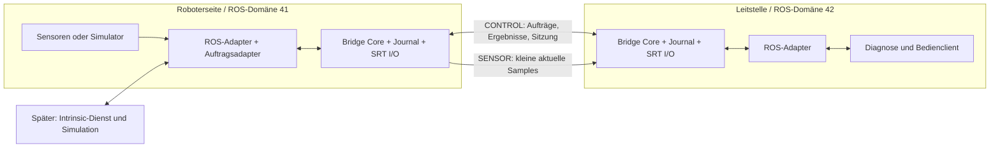

# Robotweax SRT: ROS-2-Brücke und Intrinsic-Core-Adapter

Datum: 2026-11-04 · Entwurf v0.1 · Status: M0 lokal qualifiziert, M1-Protokoll und native Sitzungen geprüft

Dieses Dokument legt den ersten Implementierungsumfang fest. Die
[HANDOFF.md](HANDOFF.md) enthält Arbeitsreihenfolge, Einstieg und Abnahmekriterien.
Der umgesetzte Teilumfang ist im README und in den Nachweisen markiert.
Alle übrigen neuen Pakete, APIs, Konfigurationsdateien und Tests sind weiterhin
**zu implementieren**. Bestehende Upstream-Schnittstellen werden ausdrücklich
als solche bezeichnet. Es liegt kein Integrationsbenchmark vor. Den tatsächlichen Implementierungs- und
Prüfstand dokumentieren [README.md](README.md) und die
[M0-Evidenz](evidence/m0-2026-11-04/README.md); die übrigen Komponenten sind weiterhin geplant.

## 1. Ziel und erster Anwendungsfall

Zwei ROS-2-Systeme tauschen über eine beeinträchtigte IP-Verbindung ausgewählte
kleine Sensornachrichten und bestätigte übergeordnete Aufträge aus. Robotweax SRT
liefert dafür zwei explizite Transportprofile:

- **SENSOR:** aktuelle, voneinander unabhängige Samples; FEC ohne DATA-ARQ.
- **CONTROL:** vollständige, geordnet zugestellte Anwendungsnachrichten mit ARQ.

Der erste Demonstrator überträgt simulierte IMU- und Gelenkzustände von einer
Roboterseite zu einer Leitstelle. Die Leitstelle ändert mit einem CONTROL-Auftrag
die Messrate eines simulierten Geräts und erhält ein überprüfbares Ergebnis.
Anschließend wird dieselbe Brücke für Zustandsbeobachtung und einen simulierten
Diagnoseauftrag an Intrinsic Core angebunden.

Das erste Produktziel ist eine selektive WAN-Brücke. Ein vollständiges `rmw_srt`,
automatische Übertragung des gesamten ROS-Graphen, Motor-Sollwertströme, Not-Halt,
harte Echtzeit, große Bild-/Punktwolkentransfers und allgemeine ROS-Actions gehören
nicht zum MVP. Für Bilder bleibt ein gesonderter LIVE-Medienpfad möglich.

## 2. Quellenstand und Abhängigkeiten

| Komponente | Festgelegte Ausgangsbasis | Bedeutung |
| --- | --- | --- |
| Lokaler SRT-Checkout | `09ceab33e1fc190472558fdb4d873f38b76fa320`, CMake-Version 0.2.8 | Für die erste Analyse gelesen; älter als der Implementierungskandidat. |
| SRT-Implementierungskandidat | `52be7c86ee1f303cbb0c8718c364217e4dd97a36`, CMake-Version 0.3.1 | CONTROL, SENSOR und SESSIONAUTH-Dokumentation sowie Buildoptionen gelesen; Build/Laufzeit in M0 noch zu qualifizieren. |
| Intrinsic Core | `723c3ee01f155f7a8bb04e449d917fe8ac5784e9` | README und ICON-/ROS-2-Brücke gelesen; kein Intrinsic-Lauf ausgeführt. |
| ROS-MVP | ROS 2 Jazzy, Ubuntu 24.04, Linux amd64 | Beide Brückenenden mit identischen ROS-Typ-Paketen; Paketversionen und Image-Digest in M0 festhalten. |
| Intrinsic-Ausbau | ROS-Umgebung des gepinnten Intrinsic-Runtimes | README nennt Lyrical. Eigener Build und eigene Integrationsspur; Jazzy-Binaries nicht in dessen Prozess laden. |

Ein SHA ist eine reproduzierbare Referenz, keine Produktionsfreigabe. M0 erstellt
`baselines/dependencies.json` mit tatsächlichen SHAs, Image-Digests, ROS-/RMW-
Paketversionen, Compiler, OpenSSL und Buildflags. Änderungen daran werden als
neue Vergleichsbasis dokumentiert. `srt_getversion()` ist die kompatible SRT-API-
Version und identifiziert weder Robotweax-Release noch aktivierte Erweiterungen.

Die Quellen [S1–S6](#12-quellen) sind für Profilverträge maßgeblich. Der lokale
Checkout wird durch diese Dokumentation weder aktualisiert noch umgebaut.

## 3. Architektur und Verantwortlichkeiten

Repository-Zuordnung (Projektübernahme 2026-11-04): M0–M3 und die generische
ROS-2-Brücke liegen in
[Robotweax/ros-2-srt-bridge](https://github.com/Robotweax/ros-2-srt-bridge).
Der spätere Intrinsic-Adapter M4 liegt in
[Robotweax/intrinsic-core-srt-integration](https://github.com/Robotweax/intrinsic-core-srt-integration).
SRT bleibt eine separat installierte Abhängigkeit.



Pro Gegenstelle werden zwei getrennte SRT-Verbindungen verwendet. Die
Roboterseite ist im MVP Caller für beide Verbindungen; die Leitstelle Listener
auf zwei festen UDP-Ports. CONTROL ist bidirektional. SENSOR sendet im MVP von
der Roboterseite zur Leitstelle. Eine Listener-Rolle verhindert nicht das Senden
von Aufträgen über die bereits aufgebaute CONTROL-Verbindung.

| Geplantes Paket | Zuständigkeit |
| --- | --- |
| `robotweax_srt_bridge_core` | ROS-unabhängige C++20-Bibliothek: Wire-Format, Routen, Sitzungen, Zeitmodell, begrenzte Queues, SRT-I/O und Auftragsjournal. |
| `robotweax_srt_bridge_msgs` | Eigene Auftrags-/Statusschnittstellen, typisierte Fehler und Diagnosemeldungen. |
| `robotweax_srt_bridge` | `rclcpp`-Node, typisierte ROS-Adapter, Konfiguration, Lifecycle und lokale QoS. |
| `robotweax_srt_bridge_demo` | Simulator, idempotenter Messraten-Handler, Client und Assertions. |
| `robotweax_intrinsic_adapter` | Späterer Adapter zu freigegebenen Intrinsic-Schnittstellen außerhalb des Echtzeitthreads. |

Der Core verwendet nur `<srt/srt.h>` und den installierten CMake-Target
`RobotweaxSRT::srt`. Ein SRT-Provider pro Prozess; keine Verknüpfung mit einer
zweiten libsrt-Implementierung. Vorhandene FEC-, Crypto- und Recovery-Engines
werden verwendet, nicht nachgebaut.

Ein I/O-Owner verwaltet Sockets, epoll, Verbindungszustand und Reconnect.
ROS-Callbacks legen begrenzt besessene Daten in Queues; sie warten weder auf
Netzwerk noch auf Journal-I/O. Ein begrenzter Worker übernimmt SQLite; Auftragsausführung benötigt eine
separate, widerrufbare Startfreigabe außerhalb des I/O-Owners. Anwendungscallbacks laufen außerhalb interner Locks.
Shutdown beendet Admission, löst lokale Futures mit einem belegbaren Status auf,
schließt I/O und joint Worker, bevor Speicher freigegeben wird.
Vor dem Socket-Close sind höchstens zwei Sekunden für Anwendungsbestätigungen
vorgesehen. Beide Sockettypen setzen im MVP `SRTO_LINGER={0,0}`; der CONTROL-
Default von 180 s wird ausdrücklich nicht übernommen. Noch unbestätigte Aufträge
bleiben im Journal und erhalten keinen künstlichen Erfolg. Ein Close widerruft
keinen bereits beim Empfänger laufenden Auftrag. Reconnect-Waits sind abbrechbar;
der Lifecycle-Test verlangt ein vollständiges Beenden innerhalb von fünf Sekunden.

Implementierungsstand 2026-11-05: `RobotweaxBridge::transport` besitzt Sockets,
epoll, Session, Queues, Bandbreitenbudget und zwei Reconnectpläne in genau einem
Thread. Numerische IPv4-/IPv6-Endpunkte vermeiden DNS im Owner. Send/Receive sind
nichtblockierend, epoll wartet höchstens 10 ms; Arbeit pro Iteration ist begrenzt.
Die feste CONTROL-Empfangsmailbox hat 64 FIFO-Plätze; bei voller Mailbox pausiert
IN-Readiness. SENSOR bleibt latest-only pro Route. Externer Submit kopiert Payloads
begrenzt und verwendet Try-Lock. BUSY bedeutet Kapazität oder Lock-Konkurrenz.
Der ursprüngliche Ingresszeitpunkt bleibt erhalten. CONTROL-Kontexte binden Session
und CONTROL-Generation; SENSOR-Kontexte zusätzlich die SENSOR-Generation. Ein reiner
SENSOR-Wechsel verwirft keine CONTROL-Arbeit und widerruft keinen Command-Grant.
Clock-Verlust oder CONTROL-Verlust widerruft die betroffenen Grants.

Periodische Probes beginnen bereits in der Synchronisierung. Unabhängige zufällige
Jitterseeds dekorrelieren Reconnectpläne; permanente Sessionfehler bleiben gesperrt.
CONTROL-Aufträge benötigen kein erfolgreiches SENSOR-Binding.

`RobotweaxBridge::worker` startet per posix_spawn einen Linux/glibc-Child, auch nach
Start der Transportthreads. Kein Anwendungs-fork des threaded Parent. Der Child
übernimmt die einzige Journalverbindung. Private IPC v2 nutzt feste 2.048-Byte-
SOCK_SEQPACKET-Frames und maximal 64 ausstehende Requests. Der aktuelle Monotonic-
Zeitpunkt im Child bei Operationsstart schließt IPC-Wartezeit in die Deadline ein.
Standardstreams, IPC-FD und Execution-Pool-FD werden übergeben; andere Deskriptoren
werden vor exec geschlossen. Netzwerkformat und Command-Schema bleiben unverändert.

Nur neu committed LOCAL_QUEUED erzeugt ein einmaliges Sender-Ticket. GET, Duplikat,
Empfängeradmission, Ablauf und Speicherfehler erzeugen keines. COMMAND-Ingress ist
auf 56 von 64 Plätzen begrenzt; acht bleiben QUERY/STATUS vorbehalten. Vor Send
prüft der Owner Peer, Epoch, Route, Budget, Kontext, bekannte Worker-Liveness und
Deadline. Worker-Stop bzw. erkannter Fehler widerruft Tickets. Bereits begonnene
Sends können nicht zurückgenommen werden; sie bleiben dauerhaft gespeicherte
Absichten, keine Ausführungsbestätigung.

Ein frisch committed DISPATCHING erzeugt ein separates `DispatchTicket`. Die 64
asynchronen Owner-Checks bleiben Momentaufnahmen. Erst `request_command_start`
verknüpft Dispatch-Beleg und aktuelle Session-/Frischeprüfung mit einem gemeinsamen
Start-Fence. Ein versiegelter memfd-Pool besitzt 64 feste Slots mit Generationen,
Request-ID, Payloadhash und Deadline. Nur lock-free 64-Bit-Atomics sind zugelassen;
diese native Shared-Memory-ABI wird ausschließlich auf der qualifizierten
Linux-Plattform verwendet und ist kein Netzwerkformat.

Die Zustände PREPARED -> GRANTED -> RUNNING bzw. REVOKED werden atomar entschieden.
Der CAS des Child von GRANTED nach RUNNING ist der Handler-Eintrittspunkt. Widerruf
und Start haben je Fence genau einen Gewinner; der Owner widerruft vor Socket-Close
und Veröffentlichung des verlorenen Kontexts. RUNNING wird nicht nachträglich
widerrufen. Generationen und begrenzte Lebenszeiten verhindern ABA/Replays; ein nach
Child-Ausfall zurückgelassener RUNNING-Slot wird im fehlgeschlagenen Pool nicht
wiederverwendet. Hash und ID müssen dem gespeicherten Dispatch-Beleg entsprechen.

Grant-Deadline ist das Minimum aus konservativer Command-Frische, ursprünglicher
lokaler Deadline und Probe-Alter-/Driftbreiten-Qualifikation des ClockMappers.
Der Child prüft sie unabhängig vom Owner-Tick. Spätere Probes verlängern bestehende
Grants nicht. Nach Grantverlust ohne Wirkung werden REJECTED/CONTEXT_LOST oder
EXPIRED/START_DEADLINE gespeichert, bevor eine entsprechende Antwort folgt.
Ein bereits laufender Handler darf sein tatsächliches Ergebnis persistieren.

`RobotweaxBridge::endpoint` verbindet dies durch einen eigenen Koordinatorthread.
64 lokale Inputs, 64 Events, 64 verfolgte Request-IDs und 64 verlorene Sessions
begrenzen seinen Speicher. Ein Workflow läuft jeweils seriell; das ist strenger
als maximal ein Dispatch pro Route. Sender-Commit vor Send, Empfänger-Commit vor
ACCEPTED, Dispatch-Commit vor finaler Freigabe und Ergebnis-Commit vor Endstatus
werden automatisch angewendet. Kontextverlust invalidiert alte Absichten;
ausstehende IDs werden bei Reconnect bzw. fehlender Antwort abgefragt. Erneutes
Execute mit derselben ID liefert das Journal bzw. QUERY, keinen neuen Send.

Der explizit aktivierte simulierte Rate-Handler läuft im beaufsichtigten Child,
nicht auf dem Netzwerk- oder Koordinatorthread. Er prüft erwartete/neue Generation,
setzt den absoluten Wert und persistiert das belegte Ergebnis. Sein Gerätezustand
ist flüchtig (initial 200 Hz/Generation 0) und startet mit dem Worker neu. Alte
Journaleinträge bleiben historische Ergebnisse, keine aktuelle Gerätezustands-
Garantie. M2 ergänzt einen externen ROS-Handler und einen getrennten Simulator
(siehe `evidence/m2-ros-jazzy-2026-11-05/ACCEPTANCE.md`).

Der Koordinator überwacht RPC/Checks (Default 3 s). Fehler schließen Admission und
Transport. Stop widerruft nicht konsumierte Grants/Tickets sofort; nach maximal
2 s Grace folgt SIGKILL. Einmalige 4-s-Joinfrist gilt auch bei Wiederholungen.
shutdown_timeout behauptet keinen erfolgreichen Join; ein Reaper hält keinen
Owner-Speicher. Endpoint-Tests qualifizieren Ende unter 5 s bei pausiertem Child,
Timeout, konkurrierenden Produzenten und voller Callback-Mailbox. Unaufgelöste
lokale Arbeit wird nach Stop aus begrenztem Speicher als Kontextverlust gemeldet;
das ist kein Beweis, dass ein alter Auftrag nie wirkte. Bekannte dauerhafte
Endergebnisse bleiben erhalten. Physisch ununterbrechbares Kernel-I/O ist damit
nicht zeitlich qualifiziert.

ERROR ist jetzt ein eigener, begrenzter Diagnosevertrag in `errors_v1.proto`.
Die bestehende Rate-Command-Descriptoridentität bleibt unverändert. ERROR läuft nur
Caller -> Listener auf CONTROL, mit nichtnull Route/Request-ID, gültiger aktueller
Session/Epoch/Domain und monotoner Routensequenz. Der Body nennt Code, ursprüngliche
COMMAND-/QUERY-Art, deren gesendete Sequenz und begrenzten Backoff für BUSY/CAPACITY.
Keine Freitexte, Journalzustände oder Geräteergebnisse. ERROR löst kein ERROR aus;
Handshake-/Identity-/Replayfehler werden weiterhin verworfen bzw. schließen den Kanal.

Der Owner korreliert gegen einen festen Recent-Send-Cache für 64 IDs/Route-Slots,
jeweils letzte COMMAND- und QUERY-Sequenz. Fremde/alte/wiederholte Referenzen werden
nicht als Peerantwort ausgeliefert. CONTROL-Read pausiert auch vor voller eigener
Ausgangsqueue, damit begrenzte Gate-Diagnostik nicht unkontrolliert wächst. Die
normalen Queue-/Bandbreitenlimits gelten unverändert, kein Prioritäts-Bypass.

Der Endpoint antwortet mit BUSY/CAPACITY/CONFLICT/NOT_FOUND bei entsprechenden
Admission-/Queryfehlern; der Owner meldet ausgewählte Frische-/Body-Gatefehler.
Harte lokale Speicherfehler bleiben fail-closed und können vor einer Antwort den
Transport beenden. Ein empfangenes ERROR verändert das Journal nicht. Der lokale
CommandEvent enthält peer_error und peer_context, aber keinen autoritativen Entry.
Automatisches Query wird für diese ID in dieser Sitzung pausiert. Explizite Query
oder neue Sitzung setzt Reconciliation fort, niemals blindes COMMAND-Resend.
Bekannte Endergebnisse gewinnen gegen spätes ERROR; eine alte Command-Diagnose
überschreibt auch keinen persistierten Empfänger-Admit-Beleg. Ein fremder STORAGE-
Fehler vergiftet nicht das lokale Journal. Vor Admission erzeugte Diagnose reserviert
keinen Empfänger-Request; deshalb bleibt die Senderabsicht dauerhaft maßgeblich.

Das CMake-SDK exportiert aktivierte RobotweaxBridge-Targets, Header, Protobufquellen
und Worker. Ein installierter Consumer wird nach Verschiebung des gesamten Prefix
neu gebaut und führt echte geschützte Sessions samt durable Command/Status und
Duplikatsperre aus. Fehlende Required Components werden abgewiesen; Linkprüfung
schließt ROS und eine zweite libsrt im Consumer aus. SRT bleibt ein separat
qualifizierter installierter Provider. Ein unabhängig installiertes Minimal-Core-
Paket ist auch ohne SRT/Protobuf/OpenSSL/SQLite/ROS auf macOS arm64 geprüft.

## 4. Transport- und Sicherheitsprofil

### 4.1 Verbindliche MVP-Einstellungen

| Eigenschaft | CONTROL | SENSOR |
| --- | --- | --- |
| Transporttyp | `SRTT_CONTROL` | `SRTT_SENSOR` |
| Nachrichtenmodell | Geordnet, vollständig, ARQ/FileCC | Ein Sample pro Message, FEC/LiveCC, kein DATA-ARQ |
| `msgttl` | Negativ; endliche Werte unzulässig | Restliches Sample-Zeitbudget in ms; bereits abgelaufene Samples nicht senden |
| `inorder` | Vom Profil erzwungen | `0` |
| TSBPD / TLPKTDROP | Aus / aus | Aus / aus |
| Anwendungsobergrenze | 4.096 Byte pro Nachricht einschließlich Envelope | 1.024 Byte einschließlich Envelope |
| Crypto | Explizites AES-GCM, enforced encryption | Explizites AES-GCM, enforced encryption |
| Sessionauth | `SRTO_ROBOTWEAX_SESSIONAUTH=true`, v2 | `SRTO_ROBOTWEAX_SESSIONAUTH=true`, v2 |
| I/O | Nichtblockierend, epoll | Nichtblockierend, epoll |

Build: `ENABLE_AEAD_API_PREVIEW=ON`, OpenSSL-Backend. Experimentelles ACP1,
experimentelle Controller/Filter und Bonding sind im MVP aus. Caller/Listener
passt zur SESSIONAUTH-v2-Grenze; Rendezvous ist nicht Teil dieser Konfiguration.
Jeden Optionssetter prüfen, vor Nutzdaten das ausgehandelte GCM und den
Schlüsselzustand prüfen. Kein Rückfall auf CTR, Klartext, LIVE oder FILE.

SENSOR verwendet fest `fec-sensor-v1,cols:4,rows:1,arq:never`. Eine verlorene
Quelle je Viererreihe kann mit verfügbarer Parität rekonstruiert werden; größere
Verluste bleiben möglich. FEC-Reparatur kann Samples nach neueren Samples liefern.
Die dokumentierte Empfangslückenfrist von 20 ms ist keine End-to-End-Garantie.
Bei niedriger Rate hängt die Reparaturzeit auch vom Füllen der FEC-Reihe ab.

Die 1.024-Byte-Grenze ist eine bewusste MVP-Grenze unter dem üblichen SENSOR-
Default von 1.316 Byte. Bei IPv6/MSS 1280 nennt der GCM/FEC-Vertrag 1.196 Byte;
SESSIONAUTH mit FEC reserviert zusätzlich 40 Byte. M0 muss die gewählte Grenze
mit der exakten Kombination und beiden Adressfamilien bestätigen. Beide Enden
setzen dieselbe `SRTO_PAYLOADSIZE`. SENSOR fragmentiert keine großen Messages;
Übergröße wird vor dem SRT-Aufruf abgelehnt und gezählt.

GCM schützt Nutzdaten; SESSIONAUTH v2 ergänzt frische Sitzungsbindung,
Schlüsselmanagement und authentisierte FEC-Parität. Gewöhnliche ACK/NAK/Shutdown-
Pakete und nicht alle Handshake-Felder sind dadurch authentisiert. Stream ID ist
Routinginformation. Autorisierung erfolgt über die lokal konfigurierte
Gegenstelle und deren Routenfreigaben, nicht über einen frei gewählten Stream ID.
Pro Gegenstellenpaar ein eigener hochentropischer Schlüssel aus dem Secret-Store;
keine Secrets in YAML, CLI-Werten, Repository oder Reports. Gemeinsame
Schlüsselinhaber sind dieselbe Vertrauensgruppe; keine Vorwärtsgeheimhaltung.

### 4.2 Netzwerk, Queues und Bandbreite

Separate Verbindungen schaffen keine reservierte Netzkapazität. Ein gemeinsamer
Admission-Scheduler reserviert Budget für CONTROL und begrenzt SENSOR; er zählt
Bytes einschließlich konservativ geschätztem Transport-/FEC-Overhead. Tatsächliche
Wire-Bytes aus SRT-Statistik und Capture dienen zur Nachregelung und Validierung.
Bereits gepufferte SRT-Pakete kann dieser Scheduler nicht zurückholen.

MVP-Limits: ein Peer, acht konfigurierte Routen, CONTROL maximal 64 wartende
Nachrichten/256 KiB und ein ausgeführter Auftrag je Route. SENSOR hält je Route
nur das neueste noch nicht an SRT übergebene Sample. Das Ersetzen eines Samples
wird gezählt. CONTROL meldet `BUSY`, wenn Admission nicht möglich ist; kein
stilles Verwerfen bestätigter Aufträge. Acht der 64 Plätze und 32 KiB des Budgets
sind für Management und Auftragsstatus reserviert, damit neue COMMANDs weder
Clock-Probes noch Ergebnisabfragen vollständig verdrängen. Diese Reserve hebt
die geordnete Zustellung und mögliche Blockierung im SRT-Strom nicht auf.
Receiver- und SRT-Puffer erhalten
explizite endliche Limits und werden im Manifest erfasst. Betriebssystemdefaults
und große Puffer dürfen keine unbekannte zusätzliche Warteschlange bilden.

M1-Implementierung der Queue-/Admission-Bausteine: CONTROL bleibt FIFO. Neue
COMMANDs können höchstens 56 Plätze und 224 KiB belegen; Management/STATUS/QUERY
können die Gesamtgrenze 64/256 KiB nutzen. Abgewiesene Admission meldet BUSY und
verändert keine wartende Nachricht. SENSOR besitzt acht feste Packet-Slots, hält
nur das neueste Sample je Route, prüft Größen-/Deadline-/Sequenzgrenzen und wird
round-robin unter den sendeberechtigten Routen entnommen. Der Ratenabstand ist
`ceil(1 s / max_rate_hz)` nach erfolgreicher lokaler SRT-Übergabe; Rebind setzt ihn
nicht zurück. Ein separater fester Slot hält einen idempotenten BIND-Retry.
Unter einer verbleibenden ganzen Millisekunde wird kein Sample mehr an SRT
übergeben. Close-/Flush-Aktionen invalidieren Generationen und leeren Samples;
verlorene, noch wartende COMMAND-IDs werden zur Journalauflösung zurückgegeben.
Die Queue selbst erteilt weder ACCEPTED noch ein Ausführungsergebnis.

Ein globaler Token-Bucket und ein begrenzter SENSOR-Teilbucket reservieren
CONTROL-Rate und -Burst. Credits werden pro nichtblockierendem Sendeversuch
reserviert und genau einmal verbraucht bzw. bei Backpressure zurückgegeben.
Der IPv6-basierte Schätzer rechnet SENSOR als Envelope-Nachricht + 80 Byte
DATA-Overhead + 287 Byte Anteil maximaler authentisierter 4er-FEC-Parität.
CONTROL rechnet Nachricht + 80 Byte je 1.024-Byte-Fragment und verdoppelt das als
nominalen Retry-Puffer. Das ist eine konfigurierbare Admission-Basis, keine
Obergrenze tatsächlicher ARQ-/ACK-/Handshake-Wirebytes; M3 muss sie mit Capture
und Statistik prüfen. Budgetinstanzen und Ratenstände bleiben bei reinem
Transport-Reconnect erhalten, damit Reconnect keine neuen Burst-Credits erzeugt.

## 5. Wire-Vertrag und Sitzungsbindung

### 5.1 Envelope v1

Jede SRT-Message enthält genau ein Bridge-Envelope. Feste 96-Byte-Kopfstruktur,
Network Byte Order, keine nativen C++-Structs auf dem Wire:

| Feld | Byte | Bedeutung |
| --- | ---: | --- |
| `magic` | 4 | ASCII `RWSB` |
| `version`, `kind` | 2 + 2 | Version 1; definierter Nachrichtentyp |
| `flags`, `route_id` | 4 + 4 | Unbekannte Flags ablehnen; Route 0 für Management |
| `session_id` | 16 | Von Listener vergebene frische Bridge-Sitzung |
| `source_epoch` | 16 | Zufällige Boot-ID des sendenden Bridge-Prozesses |
| `sequence` | 8 | Monoton je Route/Richtung/Epoch; kein stiller Wrap |
| `source_monotonic_ns` | 8 | Senderzeit bei Bridge-Ingress; kein ROS-Zeitstempel |
| `clock_domain`, `valid_for_ms` | 4 + 4 | Clock-Domäne und ab Ingress geltendes Budget |
| `payload_bytes`, `reserved` | 4 + 4 | Exakte Länge; Reserved muss 0 sein |
| `request_id` | 16 | Persistente Auftrags-ID; 0 für SENSOR |

Damit bleiben maximal 928 Byte SENSOR-Payload bzw. 4.000 Byte CONTROL-Payload.
Definierte `kind`-Werte: HELLO, WELCOME, READY, BIND, SAMPLE, COMMAND, STATUS,
QUERY, TIME_PROBE, TIME_REPLY, ERROR. Die numerischen Werte, Management-Payloads
und Golden-Vektoren werden in M1 als versioniertes Protobuf-Schema festgeschrieben.
Management-Payloads verwenden begrenzte Protobuf-Nachrichten; Topics im MVP
verwenden ROS-CDR. Kein JSON mit unbeschränkten Arrays, keine dynamische
Typnachladung vom Peer. Vor Allokation Längen, Routen und Typgrenzen validieren.

Der lokale Routenmanifest enthält Typname, ROS-Typhash, Richtung, QoS-Abbildung,
Maximalgröße, Zeitbudget und Freigaben. M0 prüft die verfügbaren ROS-Typhash-APIs;
für das MVP müssen beide Enden identische Typ-Paketversionen besitzen. Ein
fehlender oder abweichender Typhash wird nicht durch Vertrauen auf den Typnamen
ersetzt. Routenmanifest und dessen SHA-256 werden kanonisch serialisiert und
beim Sitzungsaufbau verglichen. Lokale Topicnamen dürfen unterschiedlich sein;
die gemeinsam kanonisierten Felder sind ausschließlich der Wire-Vertrag.

Der in M1 implementierte kanonische Manifest ist binär: `RWRM`, Version u16=1,
Reserved u16=0, Routenanzahl u32; danach aufsteigend nach ID sortierte Routen.
Alle Zahlen sind Network Byte Order. Je Route: ID u32; Kind, globale Richtung,
QoS-Abbildung und Enabled jeweils u8; Payloadgrenze, Budget-ms, Maximalrate-Hz und
Max-inflight jeweils u32; Typname und Typhash jeweils u16-Länge plus ASCII-Bytes.
Sensor-Hashes haben `RIHS01_` plus 64 kleine Hexzeichen; Command-Schemahashes
`SHA256_` plus 64 kleine Hexzeichen. Höchstens acht Routen, Namen bis 128 Byte;
der vollständige kanonische Wert ist höchstens 1.828 Byte groß. SHA-256 umfasst
Header und sämtliche Routenfelder. Kein Hash-Fallback auf den Typnamen.

MVP-Policies: SENSOR nur Caller→Listener, Best Effort/Volatile/KeepLast(1),
1–928 Payloadbyte, 1–1.000 Hz, kein inflight-Auftrag. COMMAND nur Listener→Caller,
Request/Status-Vertrag, 1–4.000 Payloadbyte und ein inflight-Auftrag. Budgets sind
endlich (1–60.000 ms); Pilotwerte bleiben 250 ms/5 s. Enabled ist eine gemeinsam
vereinbarte Freigabe. Der ROS-Adapter muss zusätzlich die tatsächlich unterstützten
Typen/Pakete prüfen; der ROS-unabhängige Core validiert nur Typ-/Hashsyntax und
Gleichheit des lokalen Vertrags.

### 5.2 Verbindungsaufbau und Reconnect

1. CONTROL mit exakt passendem Transport-/Crypto-Profil verbinden.
2. HELLO/WELCOME über geschützte CONTROL-DATA tauschen: Version, beide Boot-IDs,
   Peer-ID, Routenmanifest-Hash und Grenzwerte. HELLO hat eine leere Session-ID;
   der Listener erzeugt eine frische Session-ID und bindet sie an diese Verbindung.
3. Nach gegenseitigem READY und gültigem Zeitmodell wird CONTROL aktiv.
   Der initiale Bridge-Handshake einschließlich Clock-/READY-Austausch ist auf drei
   Sekunden begrenzt. TIME_PROBE erlaubt genau eine offene lokale Anfrage; Antworten
   müssen zum lokalen t1 und zur aktiven Verbindung/Sitzung passen. Nach zwei Sekunden
   verfällt eine offene Probe. Beide Endpunkte initiieren eigene Probes.
4. SENSOR verbinden und BIND mit derselben Session-ID, beiden Boot-IDs und einer
   frischen zufälligen 16-Byte-`sensor_binding_id` pro SENSOR-Verbindung senden.
   READY mit Phase SENSOR_BOUND bestätigt auf CONTROL exakt diese Binding-ID;
   eine verspätete Bestätigung eines früheren SENSOR-Sockets aktiviert keinen neuen.
   CONTROL_READY trägt keine Binding-ID. BIND/READY verwenden dafür Protobuf-Feld 3.
   Die bisher unveröffentlichte v1-Spezifikation verlangt diese ID; alte Prototypen
   ohne Binding-ID werden abgelehnt. BIND ist idempotent und wird
   bis zu drei Sekunden alle 200 ms wiederholt; vorher keine Samples publizieren.
5. Jede Verbindung akzeptiert nur den passenden Peer, Profile und Nachrichtentyp.
   Unerwartete Routen oder alte Session-/Boot-IDs werden verworfen und gezählt.

M1-Präzisierung: Der Sender zählt Route-0-Management-Nachrichten über beide
Kanäle hinweg monoton. Empfangs-Highwatermarks bleiben pro Kanal getrennt, weil
CONTROL und SENSOR unabhängig ankommen. Ein BIND kann dem zugehörigen CONTROL_READY
zuvorkommen; es wird dann noch nicht bestätigt und der reguläre 200-ms-Retry kann
nach READY binden. Jede lokal erstellte Send-Aktion und jedes Socket-Ereignis trägt
zusätzlich eine lokale Verbindungsgeneration, damit ein alter Socket keinen Ersatz
invalidiert. Diese Generation ist kein Wire-Feld.

Management-Nachrichten einschließlich TIME_PROBE/TIME_REPLY sind bereits im
Synchronisierungszustand erlaubt. Die Frischeprüfung sperrt SAMPLE-Publikation
und COMMAND-Dispatch, nicht den Aufbau des Zeitmodells selbst. Die Session-ID
bindet die beiden geschützten Datenkanäle auf Anwendungsebene; sie ersetzt keine
Gegenstellenautorisierung.

CONTROL-Verlust invalidiert die gesamte Bridge-Sitzung und schließt SENSOR.
Nur SENSOR-Verlust löst einen neuen SENSOR-Bind für die laufende Sitzung aus;
Sequenzzähler laufen weiter. Samples aus einer alten Sitzung werden nie
nachgesendet. Statusabfragen nach einem Reconnect verwenden die ursprüngliche
Request-ID, aber das neue Sitzungs-Envelope. Die Request-ID ist nicht die
Session-ID und überlebt einen Prozessneustart im Journal.

Reconnect: exponentiell 250 ms bis 5 s mit Jitter, maximal 60 s pro Versuchskampagne.
Danach Zustand `FAILED` mit expliziter lokaler Wiederaktivierung.
Der implementierte Timerplan verwendet ±20 % Jitter auf den exponentiellen
Basisabstand, geklemmt auf 250 ms–5 s, drei Sekunden pro Verbindungsversuch und
eine exakte 60-s-Kampagnengrenze. Er besitzt keine Sleeps. Versuch-IDs schützen
Completions und Verlustmeldungen gegen alte Sockets; nach Cancel ist auch ein
später erfolgreicher Connect ungültig. Dieser Plan muss noch vom Produktions-I/O-
Owner mit realen Sockets, epoll und Shutdown verbunden werden. Profile,
Credentials oder Routenfehler führen direkt zu `FAILED`; kein endloser Retry.
Eine unabhängige lokale Überwachung erkennt ausbleibende SENSOR-Daten, auch wenn
SRT die Verbindung noch für lebend hält. Verbindungsstatus und Datenfrische sind
getrennte Zustände.

## 6. SENSOR: Aktualität und ROS-Semantik

MVP-Routen sind `sensor_msgs/msg/Imu` und `sensor_msgs/msg/JointState`. Für
JointState werden höchstens sechs Gelenke und Namen mit höchstens 64 UTF-8-Byte konfiguriert;
`frame_id` höchstens 64 UTF-8-Byte. Vor jedem Send zählt die tatsächliche
serialisierte Größe. Auch ein gültiger ROS-Typ kann die 928-Byte-Grenze verletzen.
Übergröße führt zu `OVERSIZE`, nicht zu Abschneiden, versteckter Fragmentierung
oder automatischem Wechsel auf CONTROL.

Lokale Ausgangs-QoS: Best Effort, Volatile, KeepLast(1). Die Eingangssubscription
wird passend zum tatsächlichen lokalen Publisher konfiguriert. Kein pauschales
Mapping aller ROS-QoS auf SRT: Transient Local, KeepAll und beliebige
Liveliness-/Deadline-Garantien werden im MVP abgelehnt. Eine lokal zuverlässige
Republikation macht einen verlorenen WAN-Sample nicht nachträglich zuverlässig.

Der Empfänger veröffentlicht nur Samples der aktiven Sitzung mit einer Sequenz
größer als die zuletzt publizierte Sequenz derselben Route. Späte FEC-Reparaturen
werden dadurch nicht als neuer Zustand ausgegeben. Lücken sind beobachtbar;
es werden keine Ersatzmessungen erfunden. Reihenfolge gilt pro Route, nicht
zwischen IMU und Gelenkzustand. Es gibt keine implizite Sensorsynchronisierung.

### Zeitmodell

`source_monotonic_ns` misst Bridge-Ingress, nicht zwingend Sensoraufnahme. Ein
ROS-Header-Zeitstempel bleibt unverändert erhalten. Aufnahmealter darf nur mit
separat belegter Clock-Abbildung ausgewiesen werden. ROS-Simulationszeit, SRT-Zeit
und monotone Hostzeit sind unterschiedliche Domänen.

Ein ClockMapper bildet Sender-Monotonzeit auf Empfänger-Monotonzeit mit einem
Offset-Intervall ab. Vier-Zeitstempel-Probes liefern ohne Symmetrieannahme
`offset ∈ [t3 - t4, t2 - t1]` für Offset „Gegenstelle minus lokal“
(t1/t4 beim jeweiligen Initiator, t2/t3 bei der Gegenstelle). Beide Endpunkte
initiieren über CONTROL eigene Probes, unabhängig von der SRT-Caller-/Listenerrolle.
So besitzt jeder Empfänger seinen lokal gemessenen t4-Wert; ein unbelegter t4-Wert
wird nicht aus der Gegenrichtung übernommen. TIME_PROBE/TIME_REPLY behalten ihre
Feldnummern; Feldnamen lauten entsprechend Initiator/Responder. Jede Antwort muss
vor Übergabe an den Mapper mit einer offenen lokalen Probe korreliert werden.
Für eine Umkehrung desselben Offset-Intervalls werden die Grenzen negiert und
vertauscht. Drift, Messunsicherheit und Alter der
Probe erweitern das Intervall. Ein angenommener Driftwert ist als Annahme zu
kennzeichnen und durch Clock-Sprung-/Drift-Tests zu qualifizieren. Extern belegte
Clock-Grenzen können den Mapper ergänzen. Ungültige oder widersprüchliche
Intervalle invalidieren ihn.

Implementierter M1-Vertrag: Drift- und Messfehlergrenzen sind explizite lokale
Konfiguration, keine aus Tests abgeleitete Hostgarantie. Der Mapper erweitert die
Probegrenzen, projiziert und schneidet konsistente Folgeintervalle und rechnet
Ereignisse vor/nach der Probe mit nach außen gerundeten Ratengrenzen um. Bei
überschrittener Intervallbreite oder Probenalter bleibt Frische unbekannt.
Epoch-/Domänenwechsel, lokaler Rücksprung, Widerspruch und Rechenüberlauf sperren
den Mapper bis zum expliziten Reset. Session-/Epoch-/Domänengates der Nachricht
müssen vor der reinen Altersrechnung greifen. Probe-Korrelation und Invalidierungsaktionen sind im Session-Baustein umgesetzt.
Der Produktions-I/O-Owner muss die Close-/Flush-Aktionen anwenden. Konkrete
begrenzte Queues und ein threaded Transport-Owner sind implementiert;
automatische Journal-Koordination und simulierter Handler sind vorhanden;
M2 ergänzt die typisierte ROS-Publikation mit finaler Session-/Sensor-Generation-,
Clock-/Deadline- und Publication-Epoch-Freigabe direkt vor dem Publish. Bereits
freigegebene Publikationen dürfen bei anschließendem Widerruf zu Ende laufen.

Aus dem Mapper entsteht ein Intervall für das Nachrichtenalter. Nur wenn dessen
obere Grenze das Routenbudget nicht überschreitet, darf ein Sample publiziert
werden. Bei unbekannter Frische ist der MVP-Datenpfad gesperrt, die Diagnose
meldet `CLOCK_UNQUALIFIED`; niemals 0 ms einsetzen. Bei Clock-/Epochwechsel alle
alten Sample-Queues verwerfen und neu synchronisieren. Default-Budget: 250 ms
für den Demonstrator, kein Versprechen für die spätere Anwendung.

## 7. CONTROL: Auftragsvertrag und Journal

CONTROL liefert Nachrichten geordnet, aber weder eine Ausführungsbestätigung
noch genau-einmalige Ausführung über Reconnects. Der MVP verwendet deshalb eine
eigene ROS-Service-Schnittstelle `ExecuteCommand` und `GetCommandStatus`.
Die Anfrage enthält eine vom Client dauerhaft verwendete Request-ID, Route und
typisierte Parameter. Die erste Antwort ist Admission/Status samt Request-ID;
der Client kann das Ergebnis abfragen. Allgemeine ROS-Services werden noch nicht
transparent getunnelt.

Erster Handler: `SetMeasurementRate` für den Simulator. Er setzt einen absoluten
Wert mit erwarteter und neuer Konfigurationsgeneration. Wiederholung derselben
ID mit identischem Inhalt gibt das gespeicherte Ergebnis zurück; eine veraltete
Generation oder dieselbe ID mit anderem Inhalt wird abgelehnt. Die Gerätewirkung
bleibt in diesem Meilenstein simuliert.

| Status | Bedeutung |
| --- | --- |
| `LOCAL_QUEUED` | Nur beim Sender angenommen; noch kein Empfängerbeleg. |
| `ACCEPTED` | Empfänger hat validiert und den Auftrag dauerhaft gespeichert. |
| `DISPATCHING` | Dauerhaft vermerkt, bevor der lokale Handler aufgerufen wird. |
| `SUCCEEDED` / `FAILED` | Handler hat ein belegtes Ergebnis geliefert; dauerhaft gespeichert. |
| `REJECTED` / `EXPIRED` | Nicht ausgeführt, mit belegbarem Ablehnungsgrund. |
| `UNKNOWN` | Wirkung unklar, etwa nach Absturz zwischen Dispatch und Ergebnisspeicherung. |

SQLite-WAL mit `synchronous=FULL` speichert auf beiden Seiten IDs, Peer, Route,
Payload-Hash, ursprüngliches Zeitbudget, Generation, Status und Ergebnis. Vor
einem Netzwerk-Send muss der Sender seine Anfrage persistieren; `ACCEPTED` wird
erst nach dauerhaftem Empfänger-Commit zurückgegeben. Vor Handler-Aufruf wird
`DISPATCHING` committed. Erst nach Ergebnis-Commit folgt die Ergebnisnachricht.
Senderstatus `ACCEPTED` ist nicht gleich `SUCCEEDED`.

Nach einem Absturz wird `DISPATCHING` zu `UNKNOWN`; keine automatische erneute
Ausführung. Ein persistiertes `ACCEPTED` ohne Dispatch-Beleg wird nach
Prozessneustart als `REJECTED` mit Grund `CONTEXT_LOST` abgeschlossen. Ebenso
werden noch nicht dispatchte Aufträge einer verlorenen Bridge-Sitzung abgelehnt.
Bereits laufende Handler dürfen ihren tatsächlichen Abschluss persistieren.
Eine ausdrücklich idempotente Gegenstelle kann die ursprüngliche ID
abfragen oder sicher abgleichen. Ein beliebiger ROS-Service besitzt diese
Eigenschaft nicht. Timeout beim Client ist kein Beweis, dass nichts ausgeführt
wurde. Statusabfragen dürfen ein vorhandenes Ergebnis liefern, auch wenn das
ursprüngliche Ausführungsbudget abgelaufen ist.

Alle Aufträge haben im MVP ein endliches Ausführungs-Startbudget, initial 5 s.
Der Empfänger prüft das konservative Alter vor Admission und unmittelbar vor
Dispatch. Bereits vor SRT wartende Zeit zählt mit. Unbekannte Frische sperrt
Dispatch. Aufträge werden nach Reconnect nicht automatisch neu gesendet;
zuerst Status abfragen. Ein Timeout oder spätes Ergebnis wird niemals in einen
neuen Auftrag mit neuer ID umgedeutet. Cancellation allgemeiner Actions ist
später gesondert zu spezifizieren: ein Cancel kann im geordneten CONTROL-Strom
hinter einer Lücke warten und ist kein Not-Halt.

Journalgrenze im MVP: 10.000 Einträge und 64 MiB logische Dateilängen für
Hauptdatei, WAL, SHM und Rollback-Journal. Standardgrenzen: WAL 8 MiB, SHM 32 KiB,
Rollback 16 KiB; die restliche Kapazität begrenzt die Hauptdatei. Das leere
Owner-Lockfile und Dateisystem-Metadaten sind nicht eingerechnet. Eine eigene
SQLite-VFS begrenzt Writes, Truncate, Preallocation und SHM-Mapping. Ein exklusiver
OS-Lock und SQLite-Exclusive-Locking erlauben genau eine Journalverbindung.

Admission legt einen festen 512-Byte-Datensatz mit reserviertem Ergebnisraum an
und hält acht Datenbankseiten frei. Jede Mutation erhält einen vorherigen
TRUNCATE-Checkpoint; maximal 64 Empfängeraufträge sind gleichzeitig aktiv,
pro Route höchstens einer DISPATCHING. Keine stillen Evictions oder Löschung
unklarer Aufträge. Fehler bei Write/Sync sperren das Journal bis Wiederöffnung
und Recovery, einschließlich Ergebnisabfragen. Automatische Langzeitkompaktierung
bleibt ein späterer Vertrag. Die Prozess-Boot-ID wechselt; Gegenstellenidentität,
Journal und Request-IDs werden zur Fehlerbehebung nicht zurückgesetzt.

Implementiert sind getrennte Sender-/Empfängerjournale mit Peer-/Rollenbindung,
kanonischem SHA-256 über Route, Rate, Budget und beide Generationen, sowie
begrenzte COMMAND-/STATUS-Protobuf-Codecs (`proto/commands_v1.proto`). QUERY hat
einen leeren Body. Senderzustände ohne endgültigen Beleg werden bei Neustart oder
Sitzungsverlust UNKNOWN und zuerst abgefragt; ein passendes gespeichertes Ergebnis
kann diesen vorläufigen Zustand auflösen. Das Budget wird durch Duplikate nie
verlängert. STATUS-Revisionen verhindern verspätete Rückstufungen.

SIGKILL-Tests prüfen fünf Commit-/Handler-Grenzen; VFS-Tests prüfen Kapazität und
injizierte Write-/Sync-Fehler. Die native IPv4-/IPv6-Harness demonstriert ein
persistiertes Ergebnis, verlorene Ergebnisnachricht und QUERY nach Reconnect und
Budgetablauf ohne erneute Wirkung. Sie prüft Frische vor und nach DISPATCH-Commit
seriell. Produktiver Transport-Owner und Generationstoken sind inzwischen vorhanden;
automatische Koordination, finale Start-Fences und kombinierte Lifecycle-Tests
sind vorhanden. ERROR-Wire-Abbildung, Query-Suspension und relocatable SDK-Consumer sind
inzwischen implementiert und qualifiziert. Das Journal bleibt eine blockierende Child-API; es ist noch kein
fertiger ROS-Auftragsdienst.

## 8. Intrinsic-Adapter

Intrinsic Core integriert ROS 2, Wahrnehmung, SDK und ICON. Die dokumentierte
`icon_hwm_controller`-Anbindung arbeitet lokal über Shared Memory. Diese
Echtzeit-/HAL-Grenze bleibt die Zuständigkeitsgrenze des lokalen Controllers [S5].

Der neue Adapter läuft als normaler Dienst außerhalb des Echtzeitthreads:

- SENSOR exportiert freigegebene kompakte Zustände und Wahrnehmungsergebnisse.
- CONTROL nimmt einen freigegebenen übergeordneten Diagnoseauftrag an und bildet
  dessen ID/Status auf eine reale, am Pin geprüfte Intrinsic-Schnittstelle ab.
- Der erste Intrinsic-Lauf verwendet Simulation und einen wirkungsarmen Auftrag.
  Es werden keine echten Roboterbewegungen als Voraussetzung des Tests benötigt.

M4 beginnt mit einer Schnittstelleninventur. Die konkrete Intrinsic-Methode,
ihre Fehler-/Abbruchsemantik und ihre Idempotenz werden anhand der tatsächlichen
API festgelegt. Dieses Dokument behauptet keine bereits vorhandene Methode
`ExecuteDiagnostic` oder einen SRT-Hardwaretreiber. Wenn der Auftragsstatus nach
einem Verbindungsabbruch nicht abfragbar ist, bleibt das Ergebnis `UNKNOWN`.
Ein reiner Zustandsadapter kann unabhängig davon fertiggestellt werden.

Die Core-Bibliothek wird für Intrinsics Toolchain erneut gebaut. Beide Enden
dieser Vergleichsspur verwenden kompatible Lyrical-Typen. Distroübergreifendes
CDR wird erst nach eigener Schema-/Serialisierungsqualifikation unterstützt.

## 9. Konfiguration und Beobachtbarkeit

Geplante Konfiguration; dies ist kein heute ausführbares Launchfile:

```yaml
bridge:
  peer_id: lab-operator
  role: caller
  control_endpoint: 127.0.0.1:10080
  sensor_endpoint: 127.0.0.1:10081
  credential_ref: robotweax/lab-pair
  sensor_payload_bytes: 1024
  sessionauth: true
  crypto: gcm
  max_clock_uncertainty_ms: 50
  routes:
    - id: 1
      kind: sensor
      type: sensor_msgs/msg/Imu
      local_topic: /robot/imu
      remote_topic: /remote/robot/imu
      max_age_ms: 250
      max_rate_hz: 200
    - id: 2
      kind: sensor
      type: sensor_msgs/msg/JointState
      local_topic: /robot/joint_states
      remote_topic: /remote/robot/joint_states
      max_age_ms: 250
      max_rate_hz: 50
    - id: 100
      kind: command
      handler: set_measurement_rate
      start_deadline_ms: 5000
      max_inflight: 1
```

Gegenstellen verwenden denselben Wire-Routenvertrag und komplementäre
Publish-/Subscribe-Rollen. Identische Topicnamen und automatische Rückbrücken
sind verboten, wenn sie Schleifen erzeugen. ROS-Domänen 41/42 sind Testdefaults;
der Harness isoliert sie zusätzlich so, dass kein direkter DDS-Pfad den WAN-Test
umgehen kann. Listener bindet zunächst nur Loopback; Lab-Interfaces werden im
Testmanifest ausdrücklich gewählt. Keine automatische Portfreigabe.

Diagnose pro Route: ingress/published, Queue-Ersetzungen, Oversize, Stale,
Out-of-order, Epoch-/Schemafehler, Rate, Altersintervalle und Clock-Abdeckung.
Pro Verbindung: RTT, FEC-Reparaturen/-Verluste, Wire-Bytes, Drops, Reconnectdauer,
GCM-Fehler und Zustand. Pro Auftrag: Admission-, Dispatch- und Ergebniszeiten,
Endstatus und Duplicate-/Conflict-Zähler. Journale und Logs enthalten keine
Schlüssel; Rohdaten und Gerätekennungen werden vor Weitergabe bereinigt.

## 10. Meilensteine und Abnahme

| Meilenstein | Liefergegenstand | Abnahme |
| --- | --- | --- |
| M0 | Gepinnte Linux-Umgebung, SRT-Consumer-Probe, Typ-/Payload- und Crypto-Prüfung | Beide Profile mit GCM+SESSIONAUTH v2 positiv, falsche Profile/Secrets negativ; konkrete Testinventur und Manifest. |
| M1 | Core, Envelope, ClockMapper, Sitzung und native Gegenstellen | Golden-Vektoren; Grenzen, Epochwechsel, Reorder und Stop/Close geprüft; kein ROS erforderlich. |
| M2 | ROS-Node, zwei SENSOR-Routen, CONTROL-Demo mit Journal | Zwei isolierte ROS-Domänen; echter Messratenwechsel mit Ergebnisbeleg; Crash-/Reconnectfälle korrekt. |
| M3 | Netzbeeinträchtigungen und Vergleich mit DDS | Reproduzierbare Artefakte, keine Semantikverletzung, dokumentierter Nutzen oder begründete Nichtüberlegenheit. |
| M4 | Intrinsic-Zustandsadapter und simulierter Auftragsadapter | Lauf in tatsächlichem gepinntem Runtime; lokale Echtzeitgrenze erhalten; Ergebnisbeleg oder explizites UNKNOWN. |

M0/M1 sind keine Robotik- oder Internetqualifikation. M2 ist kein M3-Nachweis.
Ein bestandener Simulatorlauf ist keine Freigabe realer Hardware.

### Testmatrix für M2/M3

| Profil | Netzbedingung | Wesentliche Aussage |
| --- | --- | --- |
| N0 | Unbeeinträchtigt, getrennte Endpunkte | Semantik, Grundlast und Ausgangslatenz. |
| N1 | Je Richtung 20 ms Delay, 5 ms Jitter, 1 % zufälliger Verlust | Normale beeinträchtigte Verbindung, FEC-Nutzen. |
| N2 | Je Richtung 60 ms Delay, 15 ms Jitter, 3 % Verlust | Altersgrenzen und Verlust statt veralteter Publikation. |
| N3 | Deterministisch ein bzw. zwei DATA-Verluste derselben FEC-Reihe | Reparierbare und irreparable Fälle, ohne Parität mit DATA zu verwechseln. |
| N4 | 2 s vollständige und einseitige Unterbrechung, anschließend Wiederherstellung | Frische, Statusabgleich und ausbleibende doppelte Ausführung. |
| N5 | 512 kbit/s gemeinsamer Engpass und konkurrierender Verkehr | Admission, begrenzte Queues, CONTROL-Fortschritt und SENSOR-Reduktion. |

Netem ausschließlich in isolierten Linux-Netzwerk-Namespaces/Containern;
keine Host-qdisc-Änderung. Richtung, Seeds, Queuegrößen, Rate und tatsächliche
Kernelkonfiguration festhalten. N3 benötigt einen deterministischen Packet-Fault-
Harness; Zufallsverlust ist dafür kein Ersatz. Falls ein vorhandener Network Lab
genutzt wird, dessen Revision und konkrete Fähigkeiten separat pinnen.

Workload: IMU 200 Hz, sechs Gelenke 50 Hz, CONTROL-Auftrag alle zwei Sekunden.
N0 fünf Minuten, N1/N2 je zehn Minuten mit drei vorab festgelegten Seeds;
N4 umfasst Unterbrechung vor Admission, nach Dispatch und nach Ergebnis-Commit.
N5 überlastet absichtlich und darf Samples verwerfen. Erfolg bedeutet dort
korrekte Frische und Begrenzung, nicht verlustfreie Zustellung.

Harte Gates: keine ungültige/zu alte/überholte Publikation; keine erneute Ausführung
unklarer Aufträge; keine Erfolgsmeldung ohne Ergebnisbeleg; keine Downgrades;
keine Überschreitung der konfigurierten Queues; vollständiges Beenden aller Worker.
Messausgabe: p50/p95/p99 und Maximum des Bridge-Alters, gültige/fehlende Samples,
FEC-Overhead, CONTROL-Ergebnislatenz, Reconnect, CPU und RSS. Unbekannte Alterswerte
separat zählen; keine Perzentile nur aus einem verschwiegenen günstigen Teilset.

Vergleich: dieselben Quellen/Senken, Raten, Altersregeln und Netzprofile mit
DDS Best Effort für SENSOR und DDS Reliable plus demselben Auftragsvertrag für
CONTROL. RMW und Sicherheitskonfiguration pinnen. Unterschiedliche
Authentisierung/Overheads ausdrücklich ausweisen; keine Aussage über
SRT-Überlegenheit aus einem ungleich konfigurierten Vergleich ableiten.

## 11. Offene Entscheidungen mit klarer Zuständigkeit

- **M0:** Images/Paketstände und ROS-Typhash-API verifizieren; Kandidat durch
  Consumer-/Crypto-Tests zur tatsächlichen Baseline machen.
- **M1:** Protobuf-Feldnummern, Fehlercodes, Canonical-Manifest und Golden-Vektoren
  im Code festschreiben; ClockMapper-Driftvertrag explizit testen.
- **M3:** Messungen entscheiden über Bandbreitenlimits und sinnvolle
  Anwendungsbudgets. Die oben genannten Budgets sind Pilotwerte.
- **M4:** Konkrete Intrinsic-APIs, Distro-/Toolchain-Pins und Auftragsidempotenz
  anhand eines echten simulierten Ablaufs bestätigen.
- **Später:** Mehrere Peers, allgemeine ROS-Actions, Journalkompaktierung,
  größere Datensätze und ein mögliches RMW-Backend benötigen eigene Verträge.

## 12. Quellen

- **S1:** [Robotweax CONTROL am Implementierungskandidaten](https://github.com/Robotweax/srt/blob/52be7c86ee1f303cbb0c8718c364217e4dd97a36/docs/control-profile.md).
- **S2:** [Robotweax SENSOR/FEC am Implementierungskandidaten](https://github.com/Robotweax/srt/blob/52be7c86ee1f303cbb0c8718c364217e4dd97a36/docs/packet-filter.md).
- **S3:** [SESSIONAUTH und dessen Schutzgrenzen](https://github.com/Robotweax/srt/blob/52be7c86ee1f303cbb0c8718c364217e4dd97a36/docs/session-authentication.md), [Buildoptionen](https://github.com/Robotweax/srt/blob/52be7c86ee1f303cbb0c8718c364217e4dd97a36/CMakeLists.txt).
- **S4:** [ROS-2-QoS-Verträge](https://github.com/ros2/ros2_documentation/blob/9fc6a0ffe0acb74053c1dc5339c17d31a49d308b/source/ROS-Framework/interfaces/topics/About-Quality-of-Service-Settings.rst), [Jazzy-Plattformen](https://www.openrobotics.org/blog/2024/5/ros-jazzy-jalisco-released).
- **S5:** [Intrinsic Core README](https://github.com/intrinsic-ai/intrinsic-core/blob/723c3ee01f155f7a8bb04e449d917fe8ac5784e9/README.md), [ICON-/ROS-2-Integration über Shared Memory](https://github.com/intrinsic-ai/intrinsic-core/blob/723c3ee01f155f7a8bb04e449d917fe8ac5784e9/developer_resources/learn/tutorials/interactive_tutorials/icon/ros2_bridge_tutorial.md).
- **S6:** Einstiegsbeispiele am SRT-Kandidaten: [öffentliche API](https://github.com/Robotweax/srt/blob/52be7c86ee1f303cbb0c8718c364217e4dd97a36/examples/README.md), [installierter Consumer](https://github.com/Robotweax/srt/blob/52be7c86ee1f303cbb0c8718c364217e4dd97a36/examples/installed-consumer/README.md), [Testübersicht](https://github.com/Robotweax/srt/blob/52be7c86ee1f303cbb0c8718c364217e4dd97a36/docs/testing.md). Der übergeordnete lokale SRT-Checkout bleibt älterer Quellenkontext.


## 12. Implementierter M2-Stand — 2026-11-05

`ros2/` enthält die drei ament-Pakete `robotweax_srt_bridge_msgs`,
`robotweax_srt_bridge` und `robotweax_srt_bridge_demo`. colcon baut ausschließlich
sie gegen das separat installierte CMake-SDK. `RobotweaxBridge::worker_runtime`
ist der wiederverwendbare, ROS-freie Child-Einstieg; der co-installierte
`ros_rate_worker` ergänzt den lokalen ROS-Service-Client. Privates IPC ist jetzt
Version 3, Wire bleibt Version 1; Parent und Worker gemeinsam neu bauen.

Der Simulator besitzt den tatsächlichen Rate-/Generationszustand und eine
begrenzte flüchtige ID-/Hash-Historie. Die Worker-Neustarts setzen diesen
Gerätezustand nicht zurück. Nach gesendetem Service-Aufruf ohne beobachteten
Ergebnisbeleg bleibt der Auftrag UNKNOWN. Ein Geräte- oder Simulatorneustart mit
dauerhafter Historie gehört nicht zur hier qualifizierten Implementierung.

Die Demo verwendet zwei Container auf einem temporären internen Docker-Netz,
SRT über deren IP-Adressen und lokal beschränkte DDS-Discovery in Domänen 41/42.
Es gibt keine Host-Portfreigabe. `python3 tools/run_m2.py --build-image` baut und
qualifiziert die Umgebung; ohne Option wird die vorhandene gepinnte Umgebung
verwendet. Evidenz und Grenzen stehen in `baselines/m2-acceptance.json` und
`evidence/m2-ros-jazzy-2026-11-05/`. M3-Netzbeeinträchtigung und DDS-Vergleich
sowie M4-Intrinsic bleiben offen.
